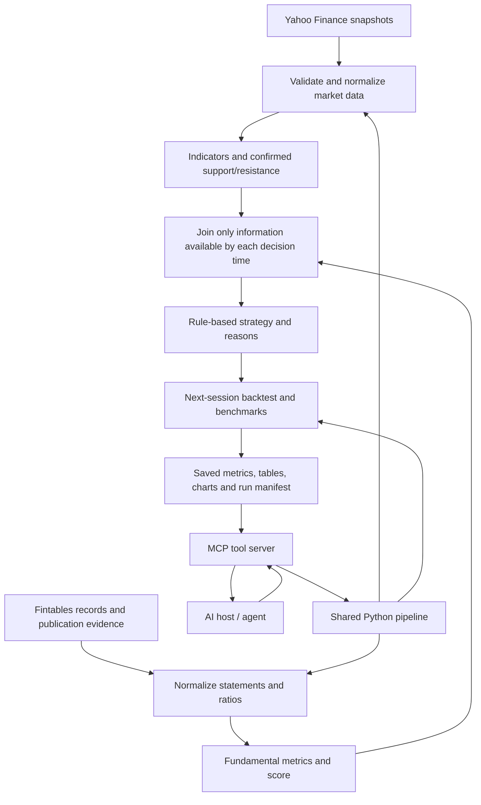

# CSE-481 Term Project: Implementation Plan

**Project:** BIST 100 Financial Analytics, Fundamental Analysis, Prediction and MCP AI-Agent Assisted Trading Strategy  
**Plan date:** 2026-09-15  
**Status:** Implementation and original annual-source validation complete. Final TRY study, report, executed notebook and real MCP agent are supplied. Presentation/rehearsal is deferred by the user.  
**Requirements source:** `CSE481_Term_Project_BIST_Python_Fintables_MCP_Final.pdf`, all 8 pages. Page references below refer to the original PDF.  
**Execution tracker:** [TASKS.md](TASKS.md)

**Confirmed scope:** The user selected **Turkish Airlines (THYAO.IS)** and authorized implementation immediately. Fintables sign-in succeeded and annual 2020-2025 tables were captured. All historical financial values remain exclusively from Fintables. See [README.md](README.md) to run the project and [docs/ACCEPTANCE.md](docs/ACCEPTANCE.md) for current evidence.

**Implementation reconciliation:** This document retains the detailed design and original acceptance gates. The implemented configuration and [decision log](docs/DECISIONS.md) supersede provisional examples below: annual financial snapshots; 2021 market warm-up; original Fintables-hosted TRY statements and TRY trading; 4x leverage cutoff; 460-day freshness; Codex CLI/MCP SDK v2. Four reports supply 136 verified observations and separately dated comparative revisions. The earlier displayed-USD study is preserved. See docs/ORIGINALS_AUDIT.md. Source correction followed inspection of that earlier study; strategy thresholds were unchanged.

**Reading guide:** Start with [scope and company choices](#1-outcome-and-recommended-scope), then [milestones](#9-milestones-dependencies-and-effort). Use the [requirement map](#2-requirement-to-evidence-map), [technical architecture](#4-architecture-and-repository-layout), [verification plan](#10-verification-plan), and [submission inventory](#12-final-deliverables-and-evidence) as references during implementation.

## 1. Outcome and recommended scope

Build a reproducible Python application that analyzes one BIST 100 company, combines technical indicators with Fintables fundamentals, evaluates an explicit trading strategy on historical data, and lets an AI agent explain the results by calling MCP tools.

The central research question is: **Does adding explainable fundamental information to a technical strategy improve its return/risk profile relative to a technical-only baseline, stock buy-and-hold, and the BIST 100?** A negative result is a valid project outcome. Success means correct methods, reproducible evidence, and a defensible explanation; it does not require profitable trading or beating the market.

### 1.1 Implemented baseline

| Decision | Working default | Reason / confirmation needed |
| --- | --- | --- |
| Company count | One company | The PDF explicitly allows one or more; one keeps financial-data verification manageable. |
| Selected company | `THYAO.IS`, Turkish Airlines | User selected; Fintables XU100 membership observed 2026-09-15. Airline currency, leasing and cash-flow conventions are documented. |
| Frequency | Daily OHLCV | Matches a semester-scale, end-of-day strategy. |
| Evaluation period | 2023-01-01 through 2025-12-31 | Follows the PDF's example window; fixed, completed years simplify reproducibility. This is a proposed window, not a mandated date range. |
| Additional price history | Start from 2021-01-01 | Supplies indicator, pivot, and valuation-history warm-up. |
| Fundamentals | FY2021-2024 Fintables-hosted original reports, with FY2020 comparatives | 136 verified observations. Original TRY presentation, actual releases and separately dated revisions. Annual updating replaces the provisional quarterly scope. |
| Baselines | Stock buy-and-hold, BIST 100, technical-only strategy | At least one benchmark is mandatory; both stock and index data are expected elsewhere in the PDF. Include all three comparisons in the plan. |
| Interface | Python package, command-line entry point, one demonstration notebook | A web dashboard is an optional presentation enhancement. |
| Trading simulation | Long or cash; one position; next-session opening execution | Makes signal timing, position accounting, and costs explicit. |
| MCP | Local Python MCP server plus an actual LLM-capable host/client | A server alone does not demonstrate an AI agent. Select and verify the host in M1. |
| Extensions | ML, macro context, multiple companies, dashboard | Start only after mandatory acceptance gates pass. |
| Execution | Implement sequential dependencies immediately | No eight-week waiting schedule. Software/report work is complete; presentation follows later, as requested. |

### 1.2 What the PDF does and does not mandate

- **Core:** Python; Yahoo Finance market data; Fintables statements and ratios; technical indicators; automatic support/resistance using pivots and clustering; fundamental scoring; a combined strategy; bias-aware backtesting; benchmarks; MCP agent; explainable outputs; final deliverables.
- **Optional:** machine-learning prediction (unless separately required by the instructor), macro features, and alternative models. The word "Prediction" in the title does not override the explicit optional wording in Section 7.
- **Examples, not fixed requirements:** ticker choices, the sample dates, SMA/RSI thresholds, score thresholds, and the 50/40/10 score weights. Explain our choices and test sensitivity.
- Section 5.3 says students "may" make a score, but the objectives, methodology, and expected outcomes explicitly include it. **Treat fundamental scoring as core.**
- There is no grading rubric, deadline, team-size rule, mandatory GUI, report length, slide count, or required return target in the PDF. Any separately issued course instructions must be added in M0.
- The PDF requires educational/research framing and says the result must not be presented as real-money investment advice or an automated advisory service (p. 8).

### 1.3 Original company shortlist (selection resolved)

All four candidates appear among the PDF's examples. The project-fit judgments below are planning assessments; they do not rank investment attractiveness or establish historical data completeness.

| Candidate | Useful project angle | Extra analysis to plan for | My assessment |
| --- | --- | --- | --- |
| **ASELSAN - `ASELS.IS`** | Defense/manufacturing subject with revenue, earnings, debt and valuation analysis | Review how contract activity, receivables and cash generation relate; document accounting comparability | **First candidate to audit.** It fits the PDF's initial example and offers a technology-oriented report topic. [Fintables company page](https://fintables.com/sirketler/ASELS) |
| **BIM - `BIMAS.IS`** | Food retail: sales, margins, inventory, working capital and cash flow | Interpret liquidity in the retail context; check lease treatment and inflation-adjustment bases in the source statements | **Good alternative if an everyday business story is preferred.** [Fintables company page](https://fintables.com/sirketler/BIMAS) |
| **Turkish Airlines - `THYAO.IS`** | Airline/transport business and an opportunity to discuss currency and operating context | Fintables identifies USD as its functional reporting currency; currency consistency requires particular attention | **Choose if the airline topic is motivating and additional financial interpretation is acceptable.** [Fintables company page](https://fintables.com/sirketler/THYAO) |
| **Tupras - `TUPRS.IS`** | Refining: earnings, operating margins, cash generation and valuation through changing business conditions | Examine the sensitivity of growth scores to the chosen comparison period and review distributions/corporate actions | **Good for a discussion of how fixed rules behave across earnings cycles.** [Fintables company page](https://fintables.com/sirketler/TUPRS) |

The user selected **Turkish Airlines** before strategy-return comparisons. The shortlist is retained as planning context; it is no longer a pending decision. Source verification and airline-specific financial conventions are recorded in the data-source and decision documents.

## 2. Requirement-to-evidence map

The IDs in this table are the submission audit. An item is done only when its evidence exists and its acceptance condition passes.

| ID | Requirement and PDF location | Planned implementation / evidence | Acceptance condition |
| --- | --- | --- | --- |
| R01 | Python and reproducibility; pp. 2, 6-8 | Packaged source, environment lock, configuration, README, run manifest | Fresh environment can reproduce a saved analysis from its inputs. |
| R02 | One or more BIST 100 companies; pp. 2, 6 | Selection rationale and dated membership evidence | Company and selection date are documented. |
| R03 | Stock and index history; OHLCV minimum; pp. 2-3, 7 | Yahoo adapter, raw snapshots, data-quality report | Dates and stock OHLCV validate; index series is identified and aligned. |
| R04 | SMA, EMA, RSI, MACD and volume analysis; pp. 2-3 | Indicator module and multi-panel chart | Values match small independently calculated fixtures; warm-up is explicit. |
| R05 | Automatic support/resistance from pivots and clustering; pp. 2, 6 | Confirmed pivot table, dated zones, chart | No pivot or cluster contributes before it becomes observable. |
| R06 | Income statement; p. 3 | Revenue, gross profit, EBITDA, operating profit, net profit | All fields have sourced values or explained unavailability. |
| R07 | Balance sheet; p. 3 | Cash, financial debt, net debt, assets, equity | Dates, units, accounting basis, and debt definitions are recorded. |
| R08 | Cash flow; p. 3 | Operating, investing, financing cash flow | Correct period basis and signs; interpretation in report. |
| R09 | Growth; pp. 2, 4, 7 | Revenue, EBITDA and net-profit growth | Comparable periods; invalid denominators and loss transitions handled. |
| R10 | Profitability; pp. 3-4 | ROE, ROA, EBITDA margin, net margin | Formula/period conventions and source reconciliation recorded. |
| R11 | Leverage and liquidity; pp. 3-4 | Net debt/EBITDA, debt/equity, current ratio, quick ratio | Required inputs exist or metrics are marked unavailable with reasons. |
| R12 | Valuation; pp. 3-4 | P/E, P/B, EV/EBITDA, valuation comparison | Historical use is supported by dated observations or valid reconstruction. |
| R13 | Fundamental score; pp. 2, 4-6, 8 | Explained five-component score and coverage flags | Each point can be traced to a value, threshold, and source period. |
| R14 | Combined technical/fundamental features and rules; pp. 3-6, 8 | Dated feature table, strategy config, buy/sell/hold log | Entries, exits, position state, missing-data policy, and score weights are explicit. |
| R15 | Backtest without look-ahead; pp. 5-6 | Simulator, position ledger, causal tests | Publication timing, pivot confirmation, order lag and costs are verified. |
| R16 | Benchmark and financial evaluation; pp. 5-6 | Equity/drawdown charts and performance table | Cumulative return, maximum drawdown, Sharpe, win rate and benchmark difference reported. |
| R17 | MCP AI agent; pp. 2, 6-8 | MCP tools, real agent session, trace and screenshots | Agent calls tools and every reported financial number has tool evidence. |
| R18 | Charts, tables, explainable conclusion; pp. 7-8 | Generated report assets and conclusions | Values agree with saved results; limitations and research framing appear. |
| R19 | Final deliverables; p. 8 | Submission inventory in Section 12 | All nine listed deliverable categories are present. |
| O01 | Optional prediction; pp. 5-6 | Time-aware ML pipeline and evaluation appendix | Only if included: classification metrics and financial comparison both provided. |
| O02 | Optional macro; pp. 3, 5-6 | Release-aware macro adapter and normalized score | Only if included: availability dates, units and weighting are documented. |

## 3. Decisions to resolve before experiments

Record each decision, owner, date and rationale in `docs/decisions.md`. The plan can proceed without these answers today; the listed implementation gates cannot.

| Decision | Default / required action | Gate |
| --- | --- | --- |
| Deadline, team, rubric and language | English used; other course details remain unknown and do not block local implementation | Submission |
| Company and evaluation window | Audit candidate coverage before inspecting strategy performance; freeze selection | M0 |
| Fintables access | Inspect accessible historical tables; manually transcribe into CSV if needed, as permitted by the PDF | M0 |
| Publication dates and data vintages | Locate dates and originally available values; preserve evidence with each record | M0/M2 |
| Incomplete historical fundamentals | Prefer another qualifying company or a shorter defensible window; disclose limitations | M0/M2 |
| Valuation benchmark | Use the company's prior valid P/E history by default; sector comparison only with dated peer data | M2/M4 |
| BIST index provider symbol | Test `XU100.IS` as a candidate and verify returned instrument identity and coverage | M2 |
| MCP host and model access | Choose an available host that supports local tools; verify one real model-to-tool call | M1 |
| Extra instructor ML requirement | Keep optional unless confirmed otherwise | M0 |

**Fintables feasibility is the first data gate.** Manual CSV entry is explicitly allowed (p. 3). Authorized signed-in table collection now supplies the included annual dataset. No public API or subscription export is assumed. Original annual-report verification is complete; strict mode uses those observations. The earlier current-vintage USD table dataset remains separate and excluded by a strict policy.

Use Fintables as the required source of the fundamental analysis. For release dates and reconciliation, seek original issuer/KAP financial-report notices and link them as supporting evidence. This supplements Fintables rather than silently replacing the required source. KAP's summary-page notes distinguish summary values from the underlying reports and warn that comparative-period corrections require consulting those reports. [KAP financial-summary notes](https://kap.org.tr/tr/sirket-finansal-bilgileri/1105-tupras-turkiye-petrol-rafinerileri-a-s)

If publication dates or original historical values are unavailable, adding an arbitrary reporting lag does not prove absence of leakage. Keep such data out of the primary historical test. A separately labeled lag-assumption experiment and a current fundamental analysis are useful fallbacks, but do not silently substitute for the required historical combined strategy. Resolve the gap through better data, a different eligible company/window, or instructor clarification.

## 4. Architecture and repository layout

### 4.1 Data and control flow



The Python package owns the calculations. The CLI, notebook and MCP server call the same functions. Store data in files and use a small run manifest; a database, cloud deployment, brokerage connection, and web service are unnecessary for the baseline.

### 4.2 Proposed technology choices

| Layer | Choice | Purpose |
| --- | --- | --- |
| Runtime | Python 3.12, virtual environment, `pyproject.toml`, `uv.lock` | Proposed reproducible baseline; confirm dependency resolution in M1. |
| Tabular analysis | pandas, NumPy | Cleaning, time alignment, indicators, financial calculations. |
| Market retrieval | yfinance | Required Yahoo-based collection route. |
| Storage | CSV inputs; Parquet processed tables via pyarrow; JSON manifests | Human-reviewable fundamental entry and typed cached analysis. |
| Configuration/contracts | YAML via PyYAML; Pydantic | Explicit parameters and structured tool responses. |
| Charts | matplotlib | Exportable figures for notebook, report and slides. |
| Support/resistance | NumPy/pandas pivot detection plus deterministic price clustering | Small, inspectable algorithm; SciPy is optional. |
| Backtesting | Small custom daily simulator | Explicit timing and accounting with no large framework dependency. |
| MCP | Official `mcp` Python SDK | Server and client support; verify the installed major version's examples. |
| Quality | pytest, Ruff | Meaningful calculation/integration checks and basic static hygiene. |
| Notebook | Jupyter | Demonstration and exploration; reusable calculations stay in the package. |
| Optional ML | scikit-learn | Logistic regression baseline; one tree model only if useful. |

Pin exact versions after the installation and MCP smoke test. As checked on 2026-09-15, the official MCP SDK documentation identifies v2 as the stable line and uses `MCPServer`; older tutorials can use different APIs. Follow documentation matching the resolved version. [Official MCP Python SDK](https://github.com/modelcontextprotocol/python-sdk)

### 4.3 Proposed structure

```text
CSE481-Term-Project/
  IMPLEMENTATION_PLAN.md
  TASKS.md
  README.md
  pyproject.toml
  uv.lock
  .gitignore
  .env.example
  config/
    project.yaml
    strategy.yaml
  data/
    raw/market/
    raw/fintables/
    raw/source_evidence/
    processed/
    manifests/
  src/bist_analytics/
    config.py
    schemas.py
    pipeline.py
    cli.py
    data/{market,fundamentals,validation,alignment}.py
    analysis/{indicators,levels,fundamentals,scoring}.py
    strategy/{rules,signals}.py
    backtest/{engine,benchmarks,metrics}.py
    reporting/{charts,tables,summary}.py
    mcp/{server,tools}.py
    ml/{features,train,evaluate}.py       # optional
  notebooks/01_project_walkthrough.ipynb
  tests/{unit,integration,fixtures}/
  docs/{proposal,methodology,decisions,data_dictionary,demo_script}.md
  outputs/<run_id>/
    manifest.json
    metrics.json
    daily_equity.csv
    trades.csv
    signals.csv
    fundamental_analysis.csv
    data_quality.json
    charts/
    agent_trace.jsonl
  report/
  presentation/
```

This tree describes future files, not existing software. Preserve raw observations; derived files can be regenerated. Keep credentials out of version control. Record which input data may be redistributed and provide collection instructions for any restricted source files.

### 4.4 Function contracts

| Function | Input | Output / responsibility |
| --- | --- | --- |
| `get_stock_history` | Ticker, start, exclusive end, download policy | Validated data reference and retrieval metadata. |
| `calculate_indicators` | Market table, indicator settings | Same dated index plus causal technical columns. |
| `find_support_resistance` | Market history, as-of time, pivot/cluster settings | Confirmed pivots and zones known by that time. |
| `get_fundamental_metrics` | Company, records, as-of time | Eligible metrics, periods, sources, quality flags. |
| `calculate_fundamental_score` | Eligible metrics and score settings | Component points, total, normalized value, completeness. |
| `generate_signal` | Available features, position state, strategy config | BUY/SELL/HOLD, desired position, reasons, decision time. |
| `run_backtest` | Frozen dataset, strategy, evaluation dates, cost assumptions | Daily equity, order/trade ledger, execution warnings. |
| `calculate_performance` | Equity, closed trades and matched benchmarks | Named metrics with units and definitions. |
| `analyze_stock` | Project config or ticker + bounded dates | Orchestrated run and artifact references. |

Prefer pure calculations separated from retrieval and file writes. MCP wrappers exchange structured summaries and server-managed dataset/run IDs rather than large DataFrames or arbitrary filesystem paths.

## 5. Data contracts and availability rules

### 5.1 Market observations

Store `ticker`, `session_date`, raw `open/high/low/close`, `adj_close`, raw `volume`, dividends/splits where supplied, `currency`, `source`, `retrieved_at`, and snapshot ID. Preserve the exact provider response separately.

Set yfinance options explicitly, including date bounds, daily interval, corporate actions and adjustment choice. Its documentation states that `end` is exclusive, automatic OHLC adjustment defaults to enabled, and output may have multilevel columns. Normalize these deliberately; do not rely on defaults. [yfinance download reference](https://ranaroussi.github.io/yfinance/reference/api/yfinance.download.html)

Validation rules:

- Unique `(ticker, session_date)`, ascending dates, consistent timezone/date interpretation.
- Positive valid prices; `low <= open/close <= high`; nonnegative stock volume.
- Report missing values, missing sessions, outliers and corporate-action discontinuities. Do not forward-fill missing OHLCV or manufacture weekend observations.
- Verify instrument identity, currency and requested coverage. Do not reject the index merely because useful volume is absent.
- Retain raw prices and derive a separate adjusted OHLC view using a consistent adjustment factor. Use the adjusted view for technical features and the primary return simulation; raw prices for historical market-cap reconstruction.
- Retries are bounded; cache by ticker, dates, options and provider/library version. A failed request cannot overwrite a valid snapshot.

### 5.2 Fundamental input table

Use a long-form source table so each observation carries its own evidence:

| Field group | Fields |
| --- | --- |
| Identity | `ticker`, `metric`, `period_start`, `period_end`, `period_type` |
| Value | `value`, `unit`, `currency`, `scale`, `statement_type` |
| Timing | `published_at`, `publication_precision`, `available_at`, `retrieved_at` |
| Provenance | `source_url`, `source_reference`, `snapshot_id`, `source_label` |
| Accounting | `consolidation_basis`, `inflation_adjustment_basis`, `restatement_version`, `value_basis` |
| Quality | `status`, `missing_reason`, `notes` |

`period_type` distinguishes standalone quarter, year-to-date, annual, trailing twelve months (TTM), and point-in-time balance sheet values. TTM means the latest four comparable quarters. Keep original million-TRY source values and normalized full-TRY amounts separately in this THYAO study; store percentages as decimals, such as `0.20` for 20%. TRY market prices and TRY financial values need no FX conversion for valuation. The separate earlier USD study uses exact-date FX.

Collect every statement and ratio in R06-R12. To compute missing ratios ourselves, also seek current assets, inventories, current liabilities, share count and any additional fields required by the chosen enterprise-value definition. These supporting inputs are implementation additions, not extra PDF deliverables.

Two-pass manual data QA: transcribe first, then independently reread each source record against the saved table. Preserve original labels and evidence. Never fill missing financial values with invented examples or treat zero and missing as equivalent.

### 5.3 Historical information must be available at the decision time

1. `period_end` describes the accounts; it is not the date investors could use them.
2. Record the original publication timestamp and the source/version of the values. Later restatements become eligible only from their own release; do not rewrite prior signals with them.
3. Conservative daily policy: a report becomes eligible for signals at the close of the first observed trading session strictly after its publication date. The resulting order executes no earlier than the following session's open. This also handles publications with date-only precision.
4. Assemble a complete metric snapshot at each eligible release. A derived metric's availability is the latest availability of its inputs.
5. Join daily decision rows to the latest eligible snapshot for that company; never backward-fill the start of the series. Use a backward as-of join, with keys sorted by the time key and company grouping. [pandas `merge_asof`](https://pandas.pydata.org/docs/reference/api/pandas.merge_asof.html)
6. Record the original period of every reused metric and its age. Provisional maximum age: 180 calendar days since the most recent eligible earnings period's release; test 150/210 days on development/validation data. A derived valuation update does not refresh the age of its earnings inputs.
7. Financials without verifiable historical eligibility can support a current snapshot analysis, but cannot enter the primary historical strategy.

**Synthetic timing example:** accounts ending March 31 and published May 10 cannot affect an April signal. Even after May 10, our conservative eligibility rule waits until the next observed session's close before generating a trade for the following open. This is a test fixture, not actual company data.

### 5.4 Comparability rules

- Choose standalone-quarter or TTM year-over-year growth consistently. Default: TTM versus the preceding year's TTM for revenue, EBITDA and net profit.
- Convert year-to-date flow figures to quarters only when accounting, inflation and restatement bases are comparable. Do not subtract balance-sheet snapshots or overlapping TTM figures to create quarters.
- Preserve inflation-adjusted versus nominal reporting labels. Compare like with like and explain what the growth figures measure.
- Average beginning/end equity or assets for ROE/ROA where comparable inputs are available; otherwise label any alternative convention explicitly.
- A currently displayed P/E value is not a historical P/E series. Use dated valuation snapshots or reconstruct with contemporaneous prices, share count and eligible earnings/equity/debt data.
- Prefer a non-financial-company baseline so the proposed EBITDA/debt scoring model can be assessed coherently. If the selected sector makes a metric unsuitable, explain and replace the score component before experiments; retain a documented applicability assessment in the analysis table.

## 6. Analysis specifications

### 6.1 Technical indicators

| Feature | Baseline specification | Important edge case |
| --- | --- | --- |
| SMA | 20 and 50 sessions, trailing close mean | Require full window; no centered windows. |
| EMA | 20 and 50 sessions; alpha `2/(n+1)`; seed with first n-session mean | Document recurrence and first valid row. |
| RSI | 14 sessions, Wilder smoothing of gains/losses | Zero loss with gain => 100; zero gain with loss => 0; both zero => 50. |
| MACD | EMA12 minus EMA26; 9-session EMA signal; histogram | Apply the documented EMA seed convention consistently. |
| Volume | Session percent change, volume/SMA20(volume), OBV | Zero previous/mean volume => unavailable ratio; unchanged close adds zero OBV. |
| Distances | Distance to available support/resistance zones as a fraction of price | No qualifying zone => null with a reason. |

Retain warm-up rows in processed data with readiness flags; exclude them from trading eligibility. Any diagnostic chart showing all-period pivots must be distinguished from the causal zones used by the strategy.

### 6.2 Automatic support and resistance

Proposed baseline algorithm:

1. A pivot high is strictly higher than highs in the preceding five and following five sessions; a pivot low is strictly lower than the corresponding lows. Ties produce no pivot under this initial definition.
2. A pivot at session `i` is confirmed only at the close of `i + 5`. Store both dates.
3. At each decision close, select confirmed pivots whose pivot dates fall within the trailing 252 observed sessions.
4. Cluster their log prices with a deterministic sorted, bounded-span algorithm: each cluster's `max(log_price) - min(log_price)` must be at most `log(1.015)`. Build clusters in ascending-price order; this avoids unlimited chaining of nearby levels.
5. Require at least two distinct pivot observations per zone. Return minimum price, maximum price, median center, touch count, most recent confirmation and evaluation date.
6. Support is the nearest zone entirely below or touching the close; resistance is the nearest zone entirely above the close. A zone containing the close is recorded separately as an in-zone condition with zero proximity distance.
7. Support distance is `(close - support_upper)/close`; resistance distance is `(resistance_lower - close)/close`. Entry proximity is support distance at most 2%, or the in-zone condition.
8. Save the daily zone snapshot. Never calculate one set of full-history clusters and apply it to earlier dates.

Acceptance: adding future observations to a fixed input snapshot cannot change earlier confirmed levels, features or decisions. Test a constructed chart where a large future pivot would otherwise create a false historical support level.

### 6.3 Fundamental formulas and interpretation

| Metric | Proposed convention |
| --- | --- |
| Growth | `current_comparable_TTM / prior_year_comparable_TTM - 1` |
| ROE / ROA | TTM net profit divided by average comparable equity / assets |
| EBITDA / net margin | TTM EBITDA / revenue; TTM net profit / revenue |
| Net debt | Financial debt minus cash, with source definitions recorded |
| Net debt/EBITDA | Latest eligible net debt / positive eligible TTM EBITDA |
| Debt/equity | Financial debt / positive equity under our definition; distinguish any differently defined source ratio |
| Current ratio | Current assets / current liabilities |
| Quick ratio | `(current assets - inventories) / current liabilities`; reconcile source adjustments |
| P/E | Contemporaneous market capitalization / positive eligible TTM net profit |
| P/B | Contemporaneous market capitalization / positive eligible equity |
| EV/EBITDA | Enterprise value / positive eligible TTM EBITDA; declare all EV components |

Keep imported Fintables ratios alongside calculated values and explain mismatches in denominator periods, consolidation, EV components, or averages. Growth with a nonpositive prior base is not scored as an ordinary percentage: report absolute change and a loss/profit transition label. Negative EBITDA cannot earn a low-leverage point simply because its debt ratio is negative. Nonpositive denominators receive an explicit invalid/not-meaningful status.

The report must discuss cash generation, liquidity, debt and valuation even if those metrics are not all used in the trading rule.

### 6.4 Explainable scores

**Fundamental score F, five points:**

| Component | Initial one-point rule |
| --- | --- |
| Revenue growth | Comparable TTM year-over-year growth > 15% |
| Net-profit growth | Comparable TTM year-over-year growth > 15%, with positive comparison base |
| Profitability | ROE > 20%, valid equity basis |
| Leverage | Net debt/EBITDA < 4, with positive EBITDA; 2x sensitivity retained |
| Valuation | Valid positive P/E <= median of its prior 252 valid trading-session observations, excluding today; minimum 63 prior observations |

Growth and profitability use the PDF's examples; the leverage cutoff is a predeclared airline case-study assumption documented in DECISIONS.md. The fifth is a reproducible within-company valuation benchmark. It describes relative historical valuation, not intrinsic fair value. Annual flows serve as 12-month totals in the implemented dataset. All historical comparison values must themselves pass the selected availability policy.

Record `points`, `eligible_components`, `status`, and component reasons. With all five components valid, normalize as `F/5` and label 0-1 weak, 2-3 neutral, 4-5 strong. If a component is missing, show the partial result as incomplete; do not silently award zero, relabel it as weak, or change the denominator. The primary strategy requires complete F. If completeness is inadequate, revise the model in development with a documented rationale and freeze the revised configuration before evaluation.

**Technical score T, five points:** SMA20 > SMA50; RSI between 35 and 55 inclusive; MACD above its signal; volume at least its 20-session mean; support proximity within 2% or in-zone. Each is one point, with the same completeness policy. Normalize as `T/5`.

**Combined score:** `C = 0.60 * (T/5) + 0.40 * (F/5)`.

This is a proposed two-component model; weights sum to one. The PDF's macro component is optional. If macro is added later, give all component scores a common scale and predeclare the new weights. Review sector rationale and sensitivity in M4/M5 rather than assuming the example financial thresholds are universally appropriate.

## 7. Strategy and backtest contract

### 7.1 Initial combined strategy

These rules are the initial research specification, subject to documented development-stage revision.

**At each session close, enter if flat and all conditions hold:**

- Required inputs are complete, eligible and sufficiently fresh.
- SMA20 > SMA50.
- Price is within 2% above an available support zone, or inside a zone.
- F >= 3 and C >= 0.70.

**If holding, request exit when any condition holds:**

- Close is at least 8% below the adjusted entry price.
- Holding duration reaches 40 trading sessions.
- Required financial score inputs become invalid/stale, or F <= 2.
- SMA20 <= SMA50, or RSI >= 70.

Otherwise HOLD: preserve the current position. HOLD while flat means remain in cash. `Signal` is an action; `position` is holdings/exposure. Never confuse a one-day BUY event with a persistent position in return calculations.

Risk/time exits take precedence, then data/fundamental exits, then trend/RSI exits. Missing support alone prevents a new entry; it does not force an existing position to close. No same-session exit/re-entry. Orders arising from close `t` execute at the next valid session's open. An 8% close-triggered exit is not an intraday guaranteed stop; opening gaps can cause larger losses.

### 7.2 Primary simulator

- Initial virtual capital: TRY 100,000; fully allocated on entry; long/cash only; fractional synthetic units for this research simulation; no leverage or shorting; cash earns zero in the baseline.
- Use adjusted OHLC consistently for the primary simulation. Adjusted units/prices are a return-analysis convention, not literal exchange shares/fills. Preserve raw/action data and disclose provider adjustment/restatement limitations. Do not add dividends a second time to an already dividend-adjusted series.
- At each open: execute yesterday's pending order with costs; update cash and units. At each close: mark equity, evaluate signals and queue the next order. Never use today's close/high/low to fill today's open.
- Illustrative cost assumptions per side: 10 basis points commission and 5 basis points slippage. One basis point is 0.01%. These are configurable research assumptions, not verified broker tariffs.
- Buy fill = adjusted open times `(1 + slippage)`; sell fill = adjusted open times `(1 - slippage)`. Size entries so trade value plus commission fits cash. Deduct commission on both entry and exit.
- Keep a parallel gross/cost-free result for explanation; the primary comparison uses the stated cost model.
- If required execution prices are absent, fail or flag the affected run and resolve the data gap; never silently fill an order at an old price. A signal on the final observation remains unexecuted.
- Final equity marks open positions to the last valid close. No invented final liquidation; report unrealized P&L and omit open trades from closed-trade win rate.
- Ledger fields: decision date, execution date, side, units, reference/fill price, fees, cash, position value, entry/exit reason, holding days and trade P&L.

The PDF's `Signal.shift(1) * Close.pct_change()` is a useful simplified illustration. It does not by itself implement next-open execution, cash accounting, corporate-action policy, or publication-time eligibility. Keep any close-to-close prototype separate from the primary simulator and reconcile timing with a hand-worked example.

### 7.3 Comparisons and metrics

Run the combined strategy, a technical-only baseline, stock buy-and-hold, and BIST 100 over the same evaluation boundaries. Start strategy segments flat; initialize prior indicator/fundamental history only as warm-up. Stock buy-and-hold enters at the first evaluation open with the same entry-cost assumptions and marks at the final close.

For the technical-only ablation, use the same technical definitions and support/trend entry gates, replace the F/C conditions with `T >= 4`, and remove fundamental exits. Keep all other execution/risk settings identical. This tests a specified change in score composition and exits, rather than isolating one individual ratio's effect. Compare on the common eligible analysis window and report any remaining differences in data availability/exposure.

The index is a reference series, not a directly executable portfolio. Verify whether it is a price or total-return index, label it accordingly, and disclose differences from dividend-adjusted stock results. Attempt the Yahoo index download even though the benchmark clause allows buy-and-hold alone; any unavailable index expected outcome remains an explicit exception to resolve.

| Output | Definition / reporting rule |
| --- | --- |
| Cumulative return | Final equity / initial capital - 1 |
| CAGR | Annualize using actual elapsed calendar years; label short samples |
| Annualized volatility | Sample standard deviation of daily returns times sqrt(252), assumed sessions/year |
| Sharpe | Mean daily excess return / sample SD times sqrt(252); baseline risk-free rate explicitly zero |
| Maximum drawdown | Most negative `equity / running_max(equity) - 1`, including initial capital in the running peak |
| Win rate | Closed trades with positive net P&L / number of closed trades |
| Benchmark difference | Strategy cumulative return minus benchmark cumulative return, in percentage points |
| Diagnostics | Trade count, exposure, turnover, total fees, gross/net return, unrealized P&L |

Include the return from initial capital to the first marked equity observation; do not lose first-entry fees or first-day P&L through `pct_change`. Undefined ratios or no-trade win rates are null with explanation, not zero or infinity. A small number of trades limits what can be concluded.

### 7.4 Evaluation design

- Proposed split: 2023 development; 2024 validation; 2025 final holdout. Confirm available data before freezing dates; the PDF mandates no particular split.
- Freeze data snapshots, parameters and code revision before the final holdout. Do not tune on 2025 results. Report full-period descriptive results separately from the holdout.
- Development and validation may use a small predeclared, one-factor-at-a-time sensitivity analysis: technical weight 0.5/0.6/0.7 with complementary F weight; support proximity 1/2/3%; minimum F 2/3/4; cost scenarios zero/base/double. Record every run, not just the best.
- Freeze the age-policy choice and clustering settings during development; avoid searching every parameter combination. Use stability, interpretability, drawdown, activity and data quality in choosing a model, rather than maximizing return alone.
- Predeclare diagnostic flags such as fewer than 10 closed trades or exposure below 5%. Investigate on development data; do not relax the holdout strategy simply to create trades.

## 8. MCP AI-agent implementation

### 8.1 Minimal complete demonstration

Use a local stdio server for the baseline. The official SDK supports server/client implementations and standard transports; choose a compatible actual host and verify discovery/calling in M1. [Official SDK documentation](https://py.sdk.modelcontextprotocol.io/)

Expose the analysis functions in Section 4.4 through thin wrappers. Each response includes:

- Status (`ok`, `partial`, `error`) and structured data; units are explicit.
- Company, requested and effective dates, `as_of`, eligible fundamental periods and sample sizes.
- Input dataset/run identifiers, source references, configuration hash, warnings and output artifact references.
- Structured errors such as `INVALID_SYMBOL`, `NO_PRICE_DATA`, `MISSING_FUNDAMENTALS`, `INSUFFICIENT_HISTORY`, `UNSUPPORTED_PERIOD`, and `STALE_DATA`.

Validate bounded date ranges and supported symbols. Keep stdout reserved for the protocol and send diagnostic logs to stderr. The tool server selects server-managed data paths; the model does not supply executable Python or arbitrary file paths.

### 8.2 Agent workflow

1. Receive a request such as "Analyze the configured stock over the evaluation period and explain the strategy versus the benchmarks."
2. Get market-data coverage and quality; compute indicators and dated zones.
3. Get eligible Fintables metrics, their source periods, the score and reasons.
4. Run the configured strategy and obtain benchmark/performance outputs.
5. Read the returned tables/summary and explain technical context, business fundamentals, strategy behavior, risk, comparisons and limitations.
6. Reference tool-returned values and periods in the final answer; distinguish the current snapshot from historical test results.

The model explains and coordinates. Python calculates every financial value, score and performance metric. No unsupported estimate should be substituted when a tool reports missing data. The agent must not silently change thresholds or dates to make results appear stronger.

### 8.3 Demo evidence and acceptance

- Capture one successful real agent session, including tool discovery, tool arguments/results, and the final explanation.
- Capture one missing/stale-data case where the agent states the limitation and does not invent a value.
- Verify that the same config through CLI and MCP yields the same numerical outputs.
- Manually audit the final explanation's financial numbers against the saved tool responses; save that checklist.
- Keep screenshots and a trace linked to the exact run. Inspector calls and mocked model tests help development but do not replace the real AI-agent demonstration.
- Provide cached analysis inputs for reliable tool execution. If model access fails during presentation, use a previously captured genuine demo recording/trace and clearly label it; do not present a scripted narrative as a live agent run.

## 9. Milestones, dependencies and effort

The user requested immediate implementation. Milestones express dependencies, not calendar weeks. The original effort estimates are superseded by actual completion evidence in TASKS.md and docs/ACCEPTANCE.md.

| Milestone | Current state | Original effort estimate | Dependencies | Exit gate |
| --- | --- | --- | --- | --- |
| M0 - Scope and feasibility | Scope and original annual vintages verified | 4-6 h | None | Candidate/window, historical-data feasibility and proposal outline recorded. |
| M1 - Foundation and MCP spike | Implemented and tested | 6-10 h | M0 scope defaults | Reproducible environment; one real host-to-tool call; package skeleton and contracts. |
| M2 - Market and fundamental data | Original reports and publication dates verified | 18-26 h | M0; M1 for code | Valid snapshots, publication evidence, aligned eligible observations, coverage audit. |
| M3 - Analysis and scoring | Implemented; verified annual sources | 12-18 h | M2 | Technicals, causal zones, financial analyses and scores verified within the captured snapshot. |
| M4 - Strategy | Implemented and tested | 8-12 h | M3 | Explicit strategy state machine, reasons and synthetic trade scenarios. |
| M5 - Backtest and evaluation | Verified study and separate earlier study generated | 14-20 h | M4 | Accounting/timing checks pass; frozen holdout results and benchmark artifacts. |
| M6 - Complete MCP agent | Actual host demonstrations passed | 10-16 h | M1; M3-M5 | Real agent explains saved outputs accurately; failure case and evidence saved. |
| M7 - Submission and rehearsal | Report/notebook done; presentation deferred | 12-18 h | M2-M6 | Fresh-environment reproduction and deliverable audit; annual-source audit passes; presentation deferred. |

**Remaining path:** review the completed implementation and findings -> prepare presentation -> rehearse. Original-source verification, strict rerun and updated empirical conclusions are complete. The earlier retrospective study remains preserved for comparison.

If time compresses, remove ML, macro, extra companies and dashboard work first. Preserve the core data, strategy, benchmark, agent and submission requirements. If time expands, add one optional extension at a time after M6's gate.

## 10. Verification plan

Tests should challenge finance/timing assumptions with small independent expected results. Routine formatting and reversible presentation edits do not need dedicated tests.

| Test ID | Check | Why it matters |
| --- | --- | --- |
| V01 | A source download with multilevel columns, missing data, duplicates, empty response and bad prices is normalized/rejected correctly | Avoid silently analyzing the wrong table. |
| V02 | Percentage, currency scale, negative number and period-basis fixtures | Prevent 100x/1,000x errors and invalid quarter construction. |
| V03 | An unpublished report and a later restatement cannot affect an earlier signal | Enforce historical availability. |
| V04 | A derived metric is unavailable until all inputs are eligible; no initial backfill | Prevent leakage through growth/ratios. |
| V05 | Hand-calculated SMA/EMA/RSI/MACD examples and flat/monotonic price edge cases | Validate numerical conventions. |
| V06 | Pivot becomes available after its right-hand window; future clusters cannot alter earlier outputs | Prevent support/resistance leakage. |
| V07 | Zero/negative earnings, missing equity, negative EBITDA, incomplete score | Avoid misleading financial strengths and invalid ratios. |
| V08 | BUY/HOLD/SELL sequence retains position, enforces exit priority, avoids repeated buys | Verify strategy state. |
| V09 | Toy next-open trade with a large overnight gap and both-side costs matches manual ledger | Verify fill timing and cash/unit accounting. |
| V10 | No-trade, always-long, constant-price, open-final-position and missing-execution-price cases | Cover difficult performance boundaries. |
| V11 | Stock buy-and-hold agrees with always-long simulator under the same cost convention | Cross-check benchmark fairness. |
| V12 | Known equity curve reproduces cumulative return/drawdown; zero volatility/no closed trades give explicit nulls | Validate reporting and undefined statistics. |
| V13 | Prefix invariance: truncate fixed input history at t and reproduce outputs through t | Detect feature/signal use of future rows. |
| V14 | Offline rerun from frozen inputs matches saved numerical tables; network tests are separate | Ensure reproducibility without Yahoo availability. |
| V15 | Real MCP discovery and calls; schema/error checks; CLI/MCP equality; explanation audit | Demonstrate actual tool use and grounded conclusions. |
| V16 | Optional ML labels, chronological splits and preprocessing boundaries | Required only if ML is included. |

For comparisons use documented numerical tolerances and deterministic ordering. Run manifests store configuration, input hashes, source/code revision, dependency lock hash, random seeds if used, adjustment policy, evaluation window and output paths. Numerical tables should reproduce even if an LLM phrases its explanation differently.

## 11. Optional extensions

### 11.1 Machine-learning prediction

Only start after core M5 results are stable and the M6 agent path is working.

1. Target: whether close five trading sessions ahead exceeds today's close. First create the future-close column, preserve unavailable targets as null, and remove the final five unlabeled observations. The PDF's direct Boolean comparison would otherwise label unavailable future observations as false.
2. Use the already causal technical/fundamental features. No future information, final-period financial snapshot, or full-history cluster labels.
3. Start with a majority-class baseline and logistic regression; optionally compare one Random Forest. Avoid a large model search on a single stock's small dataset.
4. Use chronological development/validation/holdout boundaries. Remove training examples whose five-session target interval reaches into validation/test. Use an expanding-window splitter with a gap of at least five rows and audit actual label end dates. `TimeSeriesSplit` provides ordered splits and a configurable gap. [scikit-learn reference](https://scikit-learn.org/stable/modules/generated/sklearn.model_selection.TimeSeriesSplit.html)
5. Fit imputers/scalers and select features using training folds only; never shuffle. Freeze probability thresholds before the holdout.
6. Report accuracy, precision, recall, F1, confusion matrix, class balance and sample size. If model output drives trades, define an executable rule and evaluate return/drawdown/costs with the same simulator; classification accuracy alone is insufficient.
7. Log seeds and artifacts; compare ML to the rule-based strategy and baselines on matching dates. State that repeated quarterly fundamental values do not create independent daily financial observations.

Planning allowance: 12-20 extra hours. Macro data or a dashboard each need a separate estimate; neither is included in the baseline hours.

### 11.2 Other extensions in priority order

1. A second company to check whether conclusions depend entirely on one subject, including new financial-data QA.
2. Release-aware macro context such as USD/TRY, inflation or interest rate; never attach a monthly statistic before publication.
3. A small dashboard that reads the same saved artifacts; calculation logic remains in Python modules.

## 12. Final deliverables and evidence

| PDF deliverable, p. 8 | Planned contents | Completion check |
| --- | --- | --- |
| Python source code / notebook | Package plus executed walkthrough notebook | All calculations are reproducible and notebook runs in order. |
| README / technical setup guide | Requirements, environment setup, data collection, offline rerun, online refresh, MCP host config, tests and troubleshooting | A fresh checkout can follow the commands successfully. |
| Project proposal | Problem, research question, selected company, scope, sources, methods, evaluation, schedule and risks | Prepared early and updated to match final scope; course approval/submission if required. |
| Final report | Sections below, sourced figures and method limitations | Every financial claim points to saved evidence. |
| Fintables analysis table/dataset | Source records, normalized values, metrics, source periods, QA and evidence references | All categories in R06-R12 accounted for. |
| Backtesting results and tables | Gross/net metrics, benchmark comparison, daily equity, signals, trades, sensitivity and holdout | Same definitions/dates across figures and tables. |
| Charts and visualizations | Price with indicators/zones/trades, RSI/MACD/volume, financial growth, score history, equity, drawdown, sensitivity | Units, periods, sample sizes, sources and captions present. |
| MCP agent demonstration/screenshots | Real tool calls, trace, final explanation, missing-data behavior | Narrative numbers match tool responses. |
| Classroom presentation | Problem, data, architecture, strategy, results, agent demo and limitations | Rehearsed within instructor time limit; usable backup evidence. |

### 12.1 Final report outline

1. Abstract and research question.
2. Company/sector selection and scope.
3. Market and Fintables data: coverage, collection, units, publication timing and limitations.
4. Architecture and reproducible workflow.
5. Technical indicators and causal support/resistance method.
6. Fundamental statements, growth, profitability, leverage, liquidity, valuation and score.
7. Combined strategy, parameter rationale, execution, costs and position rules.
8. Experimental design, benchmarks, development/validation/holdout separation.
9. Results, trade activity, sensitivity and technical-only ablation.
10. MCP architecture, tool contracts, actual agent evidence and explanation verification.
11. Optional prediction results, if implemented.
12. Discussion: what fundamentals changed, where the strategy failed, uncertainty and limitations.
13. Conclusion, future work, source references and reproducibility appendix.

Include nominal-TRY versus real purchasing-power limitations, price-index versus adjusted-stock comparison, single-company selection bias, data revisions, cost assumptions and limited sample/trade counts where applicable. An educational conclusion should discuss observed evidence and uncertainty rather than tell a reader to buy a stock.

### 12.2 Proposed presentation flow

Aim for 10-12 slides, adjusted to the instructor's actual requirements: problem; company/data; architecture; technical analysis; fundamentals; strategy; bias controls; return/drawdown comparison; sensitivity/interpretation; agent demo; limitations; conclusion. Use one representative successful trade and one failure case from actual saved results. Prepare the live demo and backup before the final rehearsal.

## 13. Risk register

| Risk | Impact | Mitigation / fallback |
| --- | --- | --- |
| Historical Fintables access or original vintages missing | Blocks a defensible combined backtest | Audit in M0; manual permitted collection; alternate eligible company/window; resolve remaining exception with instructor. |
| Accounting units, YTD/quarter confusion or revisions | Invalid ratios and historical signals | Preserve source metadata; independent reread; comparability checks before calculation. |
| Yahoo outage or changed response format | Pipeline/demo interruption | Explicit adapter options, frozen snapshots, retries and separate online tests. |
| Index symbol/coverage unavailable | Missing expected market-index outcome | Verify early, retry bounded requests, use saved valid snapshot; retain buy-and-hold and track unresolved index evidence. |
| Support/pivot or publication look-ahead | Overstated strategy results | Availability timestamps, rolling confirmed clusters and prefix-invariance tests. |
| Sparse complete financial/valuation data | Very short or inactive evaluation | Coverage chart and gate before strategy tuning; revise scope transparently. |
| Too many strategy conditions or excessive tuning | Few trades or overfit findings | Small predeclared sensitivity set, untouched holdout, technical-only comparison. |
| MCP host/model access or SDK incompatibility | Agent requirement incomplete | Real connection spike in M1, pin tested versions, save genuine demo evidence in M6. |
| Agent fabricates figures or hides missing values | Unsupported conclusion | Structured responses, trace-linked values, failure-case demo and manual numerical audit. |
| Scope grows faster than remaining time | Incomplete mandatory submission | Complete M0-M7 core gates before extensions; reserve final week for integration and presentation. |

## 14. How we should execute this plan

1. Use milestone/task IDs from `TASKS.md` when requesting work, for example: "Implement M1 from the plan and report the exit-gate evidence."
2. Before each milestone, confirm its dependencies and resolve relevant open decisions. Implement one coherent increment; do not begin optional work while a core dependency is missing.
3. Save run evidence as work proceeds, update task checkboxes and record material decisions. Keep the report outline populated with completed methods/results.
4. Close a milestone only after its stated checks pass. Leave blocked items visible with a cause and next action; do not mark a partial fallback as full compliance.
5. At the end, audit R01-R19 against the submission folder and rerun the documented workflow from frozen inputs.

**First implementation session:** finish M0's company/data/host feasibility decisions, draft the proposal, then create the package/environment and perform M1's smallest real MCP tool call. Do not start model training or strategy optimization first.

## 15. Source and verification notes

The primary authority for course scope is the local eight-page requirements PDF, read in full and visually checked. External documentation was used only to verify implementation details; it does not add course requirements.

- yfinance download behavior: [official API reference](https://ranaroussi.github.io/yfinance/reference/api/yfinance.download.html), checked 2026-09-15.
- MCP SDK version and transport/server/client capabilities: [official repository](https://github.com/modelcontextprotocol/python-sdk) and [documentation](https://py.sdk.modelcontextprotocol.io/), checked 2026-09-15.
- Availability join semantics: [pandas `merge_asof`](https://pandas.pydata.org/docs/reference/api/pandas.merge_asof.html), checked 2026-09-15.
- Optional time-aware ML split: [scikit-learn `TimeSeriesSplit`](https://scikit-learn.org/stable/modules/generated/sklearn.model_selection.TimeSeriesSplit.html), checked 2026-09-15.
- Fintables entry point: [Fintables](https://fintables.com/). The user enabled signed-in access and downloaded the original attachments; source verification is recorded in docs/ORIGINALS_AUDIT.md.

The Yahoo page check for the proposed index identifier returned HTTP 429 during planning; its identity and downloadable coverage remain an M2 check. No market downloads, financial calculations, backtests, or agent integration have been performed yet. The only completed work is requirements analysis and planning.
