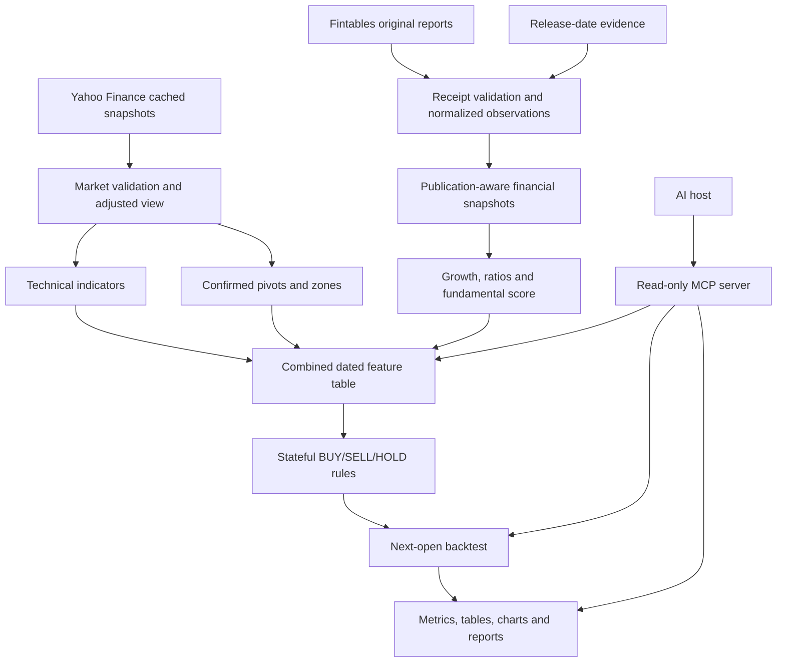

# THYAO CSE-481 Term Project: Complete Implementation and Requirements Guide

**Course:** CSE-481 Engineering Economics  
**Project:** BIST 100 Financial Analytics, Fundamental Analysis, Prediction and MCP AI-Agent Assisted Trading Strategy  
**Selected company:** Turkish Airlines (`THYAO.IS`)  
**Benchmark:** BIST 100 price index (`XU100.IS`)  
**Implementation language:** Python 3.12  
**Primary fundamental source:** Fintables-hosted original post-TMS 29 financial reports  
**Market-data source:** Yahoo Finance through `yfinance`  
**Main evaluation period:** 2 January 2025 through 25 September 2026  
**Document updated:** 27 September 2026  

> **Instructor-Q&A upgrade:** The current primary implementation uses a FY2024 post-TMS 29 anchor plus six 2025–2026 reports, 238 verified observations, timestamped KAP context, and a completed fixed-model five-stage harness run. The prior FY2020–FY2024 annual implementation described later in this document remains a reproducible baseline. The complete upgrade, current results, requirement mapping, and reproduction commands are in [INSTRUCTOR_QA_UPGRADE.md](INSTRUCTOR_QA_UPGRADE.md).

This document explains the completed project from beginning to end. It compares the implementation with all eight pages of `CSE481_Term_Project_BIST_Python_Fintables_MCP_Final.pdf`, describes the implementation techniques, summarizes the financial and backtest findings, identifies the exact evidence for each requirement, and states the limitations that should be discussed during the presentation.

The short conclusion is that the data, analysis, context, backtest, MCP, fixed-model harness, state, evidence gate, memory, and review queue are implemented and verified. The final human review must be performed by the student, after which the classroom presentation follows. Machine learning and macro inputs remain optional.

---

## Table of contents

1. [Project objective and research question](#1-project-objective-and-research-question)
2. [What the homework actually requires](#2-what-the-homework-actually-requires)
3. [Final scope and design decisions](#3-final-scope-and-design-decisions)
4. [System architecture](#4-system-architecture)
5. [Data collection and provenance](#5-data-collection-and-provenance)
6. [Financial-data implementation](#6-financial-data-implementation)
7. [Market-data implementation](#7-market-data-implementation)
8. [Technical-analysis implementation](#8-technical-analysis-implementation)
9. [Fundamental metrics and scoring](#9-fundamental-metrics-and-scoring)
10. [Combined strategy and signal rules](#10-combined-strategy-and-signal-rules)
11. [Backtesting implementation](#11-backtesting-implementation)
12. [MCP AI-agent implementation](#12-mcp-ai-agent-implementation)
13. [Results and findings](#13-results-and-findings)
14. [Verification and reproducibility](#14-verification-and-reproducibility)
15. [Requirement-by-requirement comparison](#15-requirement-by-requirement-comparison)
16. [Final-deliverable inventory](#16-final-deliverable-inventory)
17. [Limitations and honest claims](#17-limitations-and-honest-claims)
18. [How to reproduce and demonstrate the project](#18-how-to-reproduce-and-demonstrate-the-project)
19. [How to explain the project in a presentation](#19-how-to-explain-the-project-in-a-presentation)
20. [Final assessment](#20-final-assessment)

---

## 1. Project objective and research question

The homework asks for one reproducible workflow that combines:

- BIST stock and index market data;
- technical indicators and automatic support/resistance detection;
- Fintables financial statements and fundamental ratios;
- an explicit technical/fundamental trading strategy;
- historical backtesting without look-ahead bias;
- comparison against a benchmark;
- controlled MCP tools used by an AI agent; and
- charts, tables, and an explainable conclusion.

Our research question is:

> Does adding an explainable annual fundamental filter to a causal technical strategy change the return and risk profile for Turkish Airlines, compared with technical-only trading, THYAO buy-and-hold, and the BIST 100 price index?

This wording is deliberate. The goal is not to prove that the strategy is profitable in the future. The goal is to build and evaluate a correct, reproducible, and explainable engineering workflow. A result that underperforms a benchmark remains a valid academic result.

The completed experiment finds that the combined strategy slightly outperformed our technical-only rule over the selected period, but underperformed both long-term benchmarks. That is a useful finding: the annual fundamental filter changed trading behavior and reduced market exposure, but it did not establish a superior investment strategy.

---

## 2. What the homework actually requires

The original PDF was reviewed page by page. Several values and thresholds in the homework are explicitly examples rather than fixed specifications. Separating mandatory requirements from examples prevents us from claiming that optional work is required or that example parameters must be copied literally.

### 2.1 Mandatory core

The following items are core requirements:

1. Use Python.
2. Select one or more BIST 100 companies.
3. Obtain historical stock and BIST 100 data, with at least Date, Open, High, Low, Close, and Volume for the stock.
4. Calculate technical indicators such as SMA, EMA, RSI, MACD, and volume-based indicators.
5. Detect support and resistance automatically using pivots and clustering.
6. Use Fintables to analyze the selected company's income statement, balance sheet, cash flows, valuation, profitability, leverage, and liquidity.
7. Calculate financial growth metrics and create an explainable fundamental score.
8. Combine technical and fundamental evidence into at least one explicit trading strategy.
9. Generate buy, sell, and hold decisions.
10. Backtest without using future information.
11. Compare against at least one benchmark, such as the selected stock's buy-and-hold return or the BIST 100.
12. Report financial performance metrics such as cumulative return, maximum drawdown, Sharpe ratio, win rate, and benchmark difference.
13. Expose analytical functions as controlled MCP tools.
14. Demonstrate an AI agent calling those tools and explaining the result without inventing financial values.
15. Supply source code or a notebook, setup instructions, a proposal, final report, Fintables dataset, backtest tables, charts, an MCP demonstration, and a classroom presentation.
16. Keep the work educational and avoid presenting it as real-money investment advice.

### 2.2 Optional items

The PDF explicitly marks the following as optional:

- machine-learning prediction, unless the instructor separately requires it;
- macro variables such as inflation, interest rates, and USD/TRY in the combined score;
- alternative ML models;
- an alternative strategy beyond the required rule and benchmarks.

We did not implement an ML classifier. This is a conscious scope decision, not a missing core feature. The deterministic pipeline, causal backtest, source verification, and real MCP agent were completed first. If the instructor later makes ML mandatory, it can be added as a separate chronological extension.

We downloaded USD/TRY because it was useful during the earlier currency investigation, but the final primary valuation is entirely in TRY and does not require daily FX. We do not claim that the project includes a macroeconomic model.

### 2.3 Examples that we were allowed to change

The PDF presents sample thresholds and weights, including:

- `Net Debt / EBITDA < 2`;
- `RSI < 45`;
- a 50% technical, 40% fundamental, and 10% macro score;
- the sample ticker ASELSAN;
- an example date range; and
- example ML algorithms.

The PDF also says thresholds and weights may be changed when the rationale is explained and sensitivity is tested. We therefore use an airline-specific leverage threshold of 4.0x in the baseline, retain a 2.0x sensitivity case, use a 60% technical and 40% fundamental combined score, and exclude the unused macro component. All final values are in `config/project.yaml` and are discussed below.

### 2.4 Items absent from the PDF

The homework does not specify a mandatory GUI, database, cloud deployment, fixed report length, slide count, team size, eight-week implementation period, minimum profit, or exact number of trades. We did not invent these requirements. Student names, the actual deadline, presentation duration, and any later instructor amendments remain administrative details to add before submission.

---

## 3. Final scope and design decisions

### 3.1 Selected company

We selected Turkish Airlines (`THYAO.IS`). It is present in the BIST 100 constituent table observed on the project selection date. The local evidence is `data/raw/fintables/membership.json`. This proves selection-date membership; it does not prove uninterrupted BIST 100 membership during every historical date.

THYAO is analytically useful because it creates real engineering decisions around:

- high aircraft and lease-related debt;
- international operations and currency translation;
- substantial capital spending;
- cyclicality in passenger demand and margins; and
- the difference between operational performance and tax/accounting effects.

### 3.2 Time scope

- Market warm-up: 1 January 2021 onward.
- Strategy evaluation: 1 January 2023 to the exclusive end date 1 January 2026.
- Actual first and last stock sessions: 2 January 2023 and 31 December 2025.
- Financial periods: FY2020 through FY2024.
- Fundamental refresh: annual.

The 2021-2022 market history supplies warm-up observations for moving averages, RSI, MACD, pivots, support/resistance, and valuation history. The main experiment covers three completed calendar years.

### 3.3 Currency choice

The original financial statements present values in millions of TRY, even though Turkish Airlines has a USD functional currency. The notes explain that income-statement values are translated using monthly average exchange rates, balance-sheet items use closing rates, and some equity items use historical rates. One annual FX rate cannot reverse that process exactly.

For this reason, the primary study preserves the original TRY presentation:

- raw TRY share price x nominal shares gives TRY market capitalization;
- TRY earnings support P/E;
- TRY parent equity supports P/B;
- TRY debt, cash, investments, and EBITDA support EV/EBITDA.

This prevents an approximate annual conversion from being presented as original USD data. It also means growth is nominal TRY growth, not inflation-adjusted growth or functional-USD growth.

### 3.4 Baselines

We evaluate four cases:

1. combined technical/fundamental strategy;
2. technical-only strategy;
3. THYAO buy-and-hold; and
4. BIST 100 price index.

The technical-only strategy is an ablation: it helps show how the annual financial filter changes behavior. It has its own technical entry threshold and no fundamental exits, so its trades are not required to be a strict superset or subset of combined trades.

### 3.5 Execution assumptions

- Initial capital: TRY100,000.
- Position type: long or cash, one position at a time.
- Signal time: session close.
- Execution time: next available stock-session open.
- Commission: 10 basis points per side.
- Slippage: 5 basis points per side.
- Stop: 8% close-triggered loss, executed at the next open.
- Maximum holding period: 40 stock sessions.
- Cash yield: zero.
- Units: fractional adjusted synthetic units.
- Taxes and whole-lot restrictions: not modeled.

These choices make timing and costs explicit. The backtest is an academic simulation and does not claim executable brokerage fills.

---

## 4. System architecture

The project is a Python package with a shared calculation layer. The command-line interface, notebook, reports, tests, and MCP server all use the same functions. This prevents the AI demonstration from using a separate or simplified calculation path.



### 4.1 Main repository components

| Component | Responsibility |
| --- | --- |
| `config/project.yaml` | Final ticker, dates, source policy, costs, thresholds, and weights |
| `src/bist_analytics/data/market.py` | Yahoo retrieval, validation, normalization, cached hashes, adjusted view |
| `src/bist_analytics/data/originals.py` | Original-report validation, transcription reconciliation, normalization, manifest |
| `src/bist_analytics/data/fundamentals.py` | Typed financial records, scale handling, availability dates, quality report |
| `src/bist_analytics/analysis/indicators.py` | SMA, EMA, RSI, MACD, relative volume, volume change, OBV |
| `src/bist_analytics/analysis/levels.py` | Confirmed pivots, bounded price clustering, daily support/resistance |
| `src/bist_analytics/analysis/fundamentals.py` | Growth, margins, return ratios, leverage, liquidity, valuation, calendar alignment |
| `src/bist_analytics/analysis/scoring.py` | Five fundamental points, five technical points, combined score |
| `src/bist_analytics/strategy/rules.py` | Stateful entry, hold, and exit decisions with reason codes |
| `src/bist_analytics/backtest/engine.py` | Next-open execution, fees, slippage, cash, units, trades, daily ledger |
| `src/bist_analytics/backtest/metrics.py` | Return, CAGR, volatility, Sharpe, drawdown, win rate, exposure, costs |
| `src/bist_analytics/pipeline.py` | Builds one analysis and writes reproducible outputs |
| `src/bist_analytics/mcp/server.py` | Nine bounded, read-only MCP tools |
| `src/bist_analytics/reporting.py` | HTML/Markdown report tables, charts, explanations, warnings |
| `tests/` | Arithmetic, timing, source, state, performance, and future-independence checks |

### 4.2 Technology choices

- Python 3.12 for the required implementation language.
- pandas and NumPy for time-series and financial calculations.
- `yfinance` for Yahoo Finance retrieval.
- Matplotlib for exportable charts.
- PyArrow/Parquet for exact processed feature storage.
- Pydantic for configuration and financial-observation contracts.
- PyYAML for human-readable configuration.
- Official MCP Python SDK 2.2 for the tool server.
- pytest for targeted behavioral checks.
- Ruff for static code hygiene.
- Jupyter for the executed walkthrough.
- ReportLab and Poppler for the printable report and its visual verification.

SciPy and scikit-learn are recommended libraries in the homework, not mandatory dependencies. The clustering algorithm is deliberately small and deterministic, so SciPy is unnecessary. Scikit-learn is unnecessary because the optional ML extension was excluded.

---

## 5. Data collection and provenance

### 5.1 Market data

The cached market inputs are:

- `THYAO.IS`: Turkish Airlines stock OHLCV and corporate actions;
- `XU100.IS`: BIST 100 price index; and
- `TRY=X`: USD/TRY close for the preserved earlier USD analysis and optional secondary market-cap view.

`yfinance.download` is called with explicit daily interval, `auto_adjust=False`, actions enabled, repair disabled, single-thread execution, and an exclusive end date. Each cached CSV has adjacent metadata containing the original request, retrieval time, provider version, SHA-256 hash, and quality statistics.

The final snapshot contains:

| Series | Rows | First date | Last date |
| --- | ---: | --- | --- |
| THYAO.IS | 1,250 | 2021-01-04 | 2025-12-31 |
| XU100.IS | 1,247 | 2021-01-04 | 2025-12-31 |
| TRY=X | 1,300 | 2021-01-01 | 2025-12-31 |

The validator rejects empty data, missing OHLCV columns, duplicate or unsorted dates, invalid dates, nonfinite or nonpositive prices, invalid stock OHLC ranges, negative volume, and missing stock volume. Missing prices are never silently filled.

Yahoo stock and index calendars are not identical. The evaluation has 749 stock sessions and 746 BIST 100 observations. Three internal benchmark gaps remain missing. Risk metrics for the index use its actual available observations, while endpoint comparison uses the same evaluation endpoints. This difference is disclosed rather than hidden through forward filling.

### 5.2 Fintables original reports

The user downloaded four original annual attachments exposed through Fintables:

| Report | Pages | Publication date | Financial periods supplied |
| --- | ---: | --- | --- |
| FY2021 | 98 | 2022-03-01 | FY2021 and FY2020 comparative |
| FY2022 | 99 | 2023-03-01 | FY2022 and FY2021 comparative |
| FY2023 | 101 | 2024-04-03 | FY2023 and FY2022 comparative |
| FY2024 | 101 | 2025-02-28 | FY2024 and FY2023 comparative |

All company financial values in the final study come from these Fintables-hosted files. KAP is used only to verify publication metadata for three reports; one publication record is available directly through Fintables. No KAP financial number replaces a Fintables financial number.

The original receipts remain unchanged in `data/raw/fintables/originals/`. Each downloaded file contains a 27-byte Java byte-array wrapper before the `%PDF-` payload. The importer recognizes only that exact wrapper and validates the declared byte length. It does not execute Java or deserialize an object. Standard readable PDF copies under `output/pdf/originals/` contain the exact PDF payload bytes with only the wrapper removed.

### 5.3 Financial transcription and validation

For all four reports, PDF pages 9, 10, 11, and 13 were visually reviewed. These pages contain:

- assets;
- liabilities and equity;
- income statement; and
- cash-flow statement.

Both the current-year and comparative columns were captured. The resulting primary dataset contains:

- 17 normalized metrics;
- two columns from each of four reports;
- 136 observations;
- FY2020 through FY2024 coverage;
- 136 verified vintage rows;
- zero unverified rows;
- zero assumed publication dates; and
- zero missing source values.

Five identities were checked for all eight report columns:

1. assets = current liabilities + noncurrent liabilities + parent equity + minority equity;
2. current assets + noncurrent assets = total assets;
3. revenue + signed cost of sales = gross profit;
4. operating cash flow + investing cash flow + financing cash flow = change in cash; and
5. opening cash + change in cash = closing cash.

All 40 residuals are exactly zero in the source units.

### 5.4 Publication timing and revisions

A financial period end is not its publication date. We use the first stock-session close strictly after the verified release date as the first eligible decision time. A close decision can then execute at the next stock-session open.

The financial availability dates are:

- FY2021/FY2020 columns: 2022-03-02;
- FY2022/FY2021 columns: 2023-03-02;
- FY2023/FY2022 columns: 2024-04-04; and
- FY2024/FY2023 columns: 2025-03-03.

FY2020 values are not backdated to 2020. They first become available with the FY2021 report in March 2022. FY2025 annual results were released in 2026 and cannot enter trading decisions through the end of 2025.

Four later comparative changes are retained as new vintages rather than overwriting earlier history:

| Period | Metric | Earlier value | Later value | Later publication |
| --- | --- | ---: | ---: | --- |
| FY2022 | Investing cash flow | TRY -26.494bn | TRY -26.760bn | 2024-04-03 |
| FY2023 | Current assets | TRY 253.043bn | TRY 251.895bn | 2025-02-28 |
| FY2023 | Current liabilities | TRY 267.956bn | TRY 266.808bn | 2025-02-28 |
| FY2023 | Total assets | TRY 1,050.091bn | TRY 1,048.943bn | 2025-02-28 |

Earlier decisions continue to see the earlier version. This is an important part of preventing revision leakage.

---

## 6. Financial-data implementation

### 6.1 Typed observation model

Each financial observation records:

- ticker and metric;
- period end and period type;
- numeric value and scale;
- currency and unit;
- verified publication date;
- retrieval date;
- vintage-verification flag;
- accounting basis;
- source URL and page reference; and
- explanatory notes.

Original values are in millions of TRY and use `scale=1_000_000`. The loader applies the scale exactly once and then changes the internal scale to 1. Invalid rows fail with their CSV row number rather than being silently skipped.

### 6.2 Direct and derived metrics

Direct normalized metrics include revenue, gross profit, operating profit, parent-attributable net profit, cash, assets, parent equity, current assets, inventories, current liabilities, and the three cash-flow categories.

Derived values use transparent definitions:

```text
EBITDA = Gross Profit
         + signed Administrative Expense
         + signed Selling Expense
         + Depreciation and Amortization
```

This is not EBITDAR. No separate research-and-development line appears in the selected statements.

```text
Financial Debt = current and noncurrent bank loans
                 + current portions of long-term bank loans
                 + current and noncurrent lease debt
```

The separate “other financial liabilities” line is excluded under the chosen borrowing definition.

```text
Net Debt = Financial Debt
           - Cash
           - Current Financial Investments
           - Noncurrent Financial Investments
```

Nominal share units equal paid-in capital divided by TRY1, producing 1.38 billion units. Treasury shares are not subtracted, and this limitation is disclosed.

### 6.3 Period handling

The calculation layer distinguishes annual, year-to-date, standalone-quarter, trailing-twelve-month, instant, and ratio records. It can build TTM flows from four standalone quarters or from current YTD + prior annual - comparable prior YTD. It never adds four cumulative YTD values.

The included study uses annual flows and year-end balance-sheet instants. Flow values and balance values are not treated as the same period type.

### 6.4 Point-in-time alignment

For any market date, the pipeline selects only observations whose `available_at` is on or before that date. Within each eligible metric and period, it keeps the latest publication known by that date. There is no initial financial backfill before the first publication.

The 460-day freshness rule measures how long ago the active annual statement became available. A stale record cannot support a new combined entry and can force an exit from an existing combined position.

---

## 7. Market-data implementation

### 7.1 Raw and adjusted prices

The project preserves Yahoo raw OHLC, adjusted close, dividends, and split information. For strategy calculations, it creates a consistent adjusted OHLC view using:

```text
adjustment_factor = adjusted_close / raw_close
adjusted_OHLC = raw_OHLC x adjustment_factor
```

Raw close is retained for market capitalization, because financial valuation requires the actual quoted TRY price. Adjusted OHLC is used for indicators and the synthetic backtest. Dividends are not added separately, which avoids double counting them.

### 7.2 Cache and reproducibility

By default, the program reads validated cached files. A network refresh happens only with an explicit refresh command. Each ordinary analysis verifies that the cached file still matches its recorded SHA-256 hash.

This design supports two distinct needs:

- reproducible grading from frozen inputs; and
- an explicit future refresh route when the user intentionally wants updated market data.

---

## 8. Technical-analysis implementation

### 8.1 Indicators

The project calculates the homework's requested indicator families:

- SMA20 and SMA50;
- EMA20 and EMA50;
- RSI14;
- MACD(12,26,9) and histogram;
- daily volume change;
- 20-session mean volume;
- relative volume; and
- on-balance volume (OBV).

EMA uses a simple-average seed after a complete window, then applies the usual recurrence. RSI uses Wilder smoothing, explicitly handles all-gain, all-loss, and flat windows, and preserves warm-up nulls. Relative volume is current volume divided by its trailing 20-session mean.

### 8.2 Causal pivot detection

A pivot candidate must be higher than all five observations on both sides for a high, or lower than all five observations on both sides for a low. The future right-hand observations are required for confirmation, so the pivot becomes usable only on the fifth subsequent stock session.

The output records both:

- `pivot_date`: the location of the high or low; and
- `confirmed_at`: the date when enough later observations exist to know it was a pivot.

Only `confirmed_at` controls strategy availability. This prevents a common charting error in which future-confirmed levels are painted backward into historical decisions.

### 8.3 Support/resistance clustering

At each session close, the level algorithm:

1. keeps only pivots already confirmed on that date;
2. restricts them to the preceding 252 stock sessions;
3. sorts pivot prices;
4. groups prices within a maximum 1.5% band measured from the first price in the group;
5. requires at least two touches;
6. stores the lower edge, upper edge, median center, touch count, and last confirmation date; and
7. identifies the nearest support below price and resistance above price.

The grouping is deliberately nonchaining: a sequence of small pairwise changes cannot create a zone wider than the declared tolerance. If price lies inside a zone, its support distance is zero.

The final technical chart combines price, SMA20/50, confirmed support/resistance, RSI, MACD, and signal evidence. The underlying dated pivots and zones are also exported as CSV files.

---

## 9. Fundamental metrics and scoring

### 9.1 Growth metrics

For positive comparable annual denominators:

```text
Revenue Growth = Revenue_t / Revenue_(t-1) - 1
EBITDA Growth = EBITDA_t / EBITDA_(t-1) - 1
Net Profit Growth = Net Profit_t / Net Profit_(t-1) - 1
```

If the prior value is zero, negative, missing, or not comparable, growth is unavailable rather than a misleading percentage. This matters for FY2020, when the company reported a loss.

### 9.2 Profitability

```text
ROE = Parent Net Profit / Average Parent Equity
ROA = Parent Net Profit / Average Total Assets
EBITDA Margin = EBITDA / Revenue
Net Margin = Parent Net Profit / Revenue
```

ROE and ROA use average beginning/end balances. Parent-attributable earnings are matched to parent equity. Invalid or nonpositive denominators produce unavailable values.

### 9.3 Leverage and liquidity

```text
Net Debt / EBITDA = Net Debt / EBITDA
Debt / Equity = Financial Debt / Parent Equity
Current Ratio = Current Assets / Current Liabilities
Quick Ratio = (Current Assets - Inventory) / Current Liabilities
```

Quick ratio excludes inventory only. Airline prepayments and other less-liquid current assets can therefore make this simplified ratio look stronger than true immediate liquidity.

### 9.4 Valuation

For the primary TRY study:

```text
Market Capitalization = Raw TRY Close x Nominal Shares
P/E = Market Capitalization / Parent Net Profit
P/B = Market Capitalization / Parent Equity
Enterprise Value = Market Capitalization + Net Debt
EV/EBITDA = Enterprise Value / EBITDA
```

P/E must be positive. Invalid denominators stay unavailable. The valuation score compares today's positive P/E with the median of the previous 252 valid session values, requiring at least 63 valid historical observations. Today's P/E is shifted out of its own benchmark, preventing self-inclusion and future leakage.

### 9.5 Fundamental score

The final five-point fundamental score awards one point for each condition:

| Component | Baseline rule | Rationale |
| --- | --- | --- |
| Revenue growth | `> 15%` | Same example family as the homework |
| Net-profit growth | `> 15%` | Captures earnings expansion, unavailable after a prior loss |
| ROE | `> 20%` | Homework example |
| Net debt/EBITDA | `< 4.0x` | Declared airline case-study threshold; 2.0x tested separately |
| Valuation | positive P/E no higher than prior median | Dated company-relative benchmark |

All five components must be available before the total score is valid. Labels are:

- 0-1: weak;
- 2-3: neutral;
- 4-5: strong; and
- incomplete: one or more unavailable components.

### 9.6 Technical and combined scores

The technical score has five points:

- SMA20 > SMA50;
- RSI between 35 and 55;
- MACD above its signal;
- relative volume at least 1.0; and
- price within 2% of confirmed support or already inside a zone.

The combined normalized score is:

```text
Combined Score = 0.60 x (Technical Score / 5)
               + 0.40 x (Fundamental Score / 5)
```

The macro weight is omitted because macro scoring is optional and no macro model is claimed.

---

## 10. Combined strategy and signal rules

### 10.1 Entry rules

For a flat combined-strategy position, a BUY decision requires all of the following:

1. the technical score and support distance are available;
2. SMA20 > SMA50;
3. price is inside a confirmed zone or no more than 2% above confirmed support;
4. all fundamental score components are available;
5. the financial snapshot is no more than 460 days old;
6. fundamental score >= 3; and
7. combined score >= 0.70.

The technical-only baseline uses the same trend and support gates but requires technical score >= 4. It does not use fundamental entry or exit conditions.

### 10.2 Exit priority

For an existing combined position, exit conditions take precedence in this order:

1. closing price is at least 8% below the adjusted entry price;
2. holding period reaches 40 stock sessions;
3. fundamental score becomes missing, stale, or <= 2;
4. required technical data is unavailable;
5. SMA20 falls to or below SMA50; or
6. RSI reaches 70.

If none applies, the result is HOLD with reason `retain_position`.

When flat, HOLD means remain in cash. It does not mean “continue holding a stock.” Every signal contains a reason code, position state, input snapshot, and whether it schedules an order for the next session.

### 10.3 Example simulated trade

The first combined trade demonstrates the complete timing chain:

| Event | Date | Price/amount | Explanation |
| --- | --- | ---: | --- |
| BUY decision | 2023-05-10 close | - | All combined entry filters pass |
| BUY execution | 2023-05-11 open | TRY123.442156 adjusted fill | Next-open execution with slippage |
| Units | 2023-05-11 | 809.286737 | Fractional synthetic units after commission |
| BUY commission | 2023-05-11 | TRY99.90 | 10 bps |
| SELL decision | 2023-06-05 close | - | RSI exit |
| SELL execution | 2023-06-06 open | TRY160.128893 adjusted fill | Next-open execution with slippage |
| SELL commission | 2023-06-06 | TRY129.59 | 10 bps |
| Cash after exit | 2023-06-06 | TRY129,460.60 | Net of both sides' modeled costs |

The decision dates and execution dates are distinct. The result does not assume that a signal can trade at the same close that created it.

---

## 11. Backtesting implementation

### 11.1 Stateful simulation

The simulator iterates through stock sessions in chronological order and maintains:

- cash;
- units;
- entry date and price;
- holding-session count;
- pending next-open decision;
- fees and slippage;
- daily equity; and
- closed/open trade records.

A pending BUY or SELL is executed before that session's close decision is calculated. The engine rejects repeated entries while already long and rejects selling while flat. A sell execution has a one-session cooldown to prevent an immediate same-session re-entry decision.

### 11.2 Price and cost model

```text
BUY fill  = next open x (1 + slippage rate)
SELL fill = next open x (1 - slippage rate)
commission = units x fill x commission rate
equity = cash + units x current adjusted close
```

The final open position, if any, is marked at the last close. The program does not invent a final liquidation order. Buy-and-hold consequently has one open trade and no closed-trade win rate.

### 11.3 Performance metrics

The project reports:

- initial and final equity;
- cumulative return;
- CAGR;
- annualized volatility;
- Sharpe ratio with zero risk-free rate;
- maximum drawdown measured against a high-water mark that includes initial capital;
- closed and open trades;
- closed-trade win rate;
- market exposure;
- commission and slippage costs;
- turnover;
- unrealized P&L; and
- percentage-point difference from BIST 100.

Sharpe uses observed daily equity returns, 252 sessions, and zero risk-free return. This is a stated convention, not an inflation-adjusted performance claim.

### 11.4 Gross same-execution counterfactual

The project also replays the exact same order dates and sides with zero commission and zero slippage. This isolates the impact of modeled execution costs while holding trades fixed.

A completely new zero-cost strategy run is different: cheaper entry prices can change stop thresholds and therefore change later decisions. Both concepts are kept separate.

### 11.5 Sensitivity design

Sensitivity variants were declared for the 2023-2024 development/validation period:

- zero costs;
- 20 bps commission;
- combined entry threshold 0.65;
- combined entry threshold 0.75; and
- net-debt/EBITDA threshold 2.0x.

No sensitivity winner replaces the baseline on the basis of 2025 performance. The results are reported for robustness discussion rather than as a second optimization step.

---

## 12. MCP AI-agent implementation

### 12.1 Purpose

The homework says the LLM should call deterministic tools and should not invent financial values. Our MCP server follows that separation:

- Python calculates and validates every number.
- MCP exposes bounded structured results.
- The AI host coordinates tool calls and explains returned evidence.
- No tool sends an order or contacts a broker.

### 12.2 Tool inventory

Nine read-only tools are exposed over standard input/output:

| Tool | Purpose |
| --- | --- |
| `project_status` | Scope, source, currency, and data readiness |
| `get_stock_history` | Up to 252 cached sessions through a requested date |
| `calculate_indicators` | SMA, EMA, RSI, MACD, and volume values |
| `find_support_resistance` | Causally known zones and distances |
| `get_fundamental_metrics` | Publication-lagged financials and ratios |
| `calculate_scores` | Component points and combined scores |
| `generate_signal` | BUY/SELL/HOLD for an explicit position state |
| `run_backtest` | Strategy and baseline performance |
| `generate_report` | Existing report paths, metrics, and source quality |

All tools are annotated read-only, nondestructive, idempotent, and closed-world. Inputs are bounded to `THYAO.IS`, the cached date interval, and controlled row counts. Missing data becomes JSON `null`, not zero. Unsupported symbols and dates return structured errors.

### 12.3 Actual AI demonstration

The implementation includes three genuine authenticated Codex CLI host sessions:

1. connection smoke test;
2. full financial/technical/backtest analysis; and
3. missing-data plus invalid-symbol behavior.

The full session called all eight analysis tools and produced an explanation matching the Python results. The missing-data session queried 15 January 2021, where eligible fundamentals and warmed-up scores were unavailable. It returned nulls, a flat HOLD with a technical-warm-up reason, and an explicit invalid-symbol error for an unsupported ticker.

The raw JSONL calls, final Markdown explanations, and an offline expandable HTML viewer are stored under `outputs/agent/`. `scripts/audit_agent_evidence.py` compares every successful recorded response with the current direct Python result. The protocol test is separate and does not pretend to be an LLM demonstration.

---

## 13. Results and findings

### 13.1 Full-period strategy comparison

| Strategy | Cumulative return | Maximum drawdown | Sharpe (rf=0) | Closed trades | Win rate | Exposure |
| --- | ---: | ---: | ---: | ---: | ---: | ---: |
| Combined | **65.32%** | -13.85% | **1.08** | 8 | 87.50% | 20.16% |
| Technical-only | 61.19% | -13.16% | 1.00 | 11 | 63.64% | 26.70% |
| THYAO buy-and-hold | 92.73% | -25.61% | 0.75 | 0 closed | unavailable | 100.00% |
| BIST 100 price index | 102.24% | -22.86% | 0.97 | not applicable | unavailable | not applicable |

TRY100,000 becomes TRY165,317.12 under the combined rule after modeled costs. The combined rule exceeds technical-only endpoint return by 4.13 percentage points, but trails BIST 100 by 36.92 percentage points. It also trails THYAO buy-and-hold.

The combined rule has a slightly deeper maximum drawdown than technical-only trading, but a much smaller drawdown than buy-and-hold. Therefore, combined trading does not dominate every alternative. Its low 20.16% exposure helps limit some losses, but it also misses much of the sustained appreciation captured by long exposure.

The 87.5% win rate represents seven profitable closed trades out of eight. Eight trades are too few to support a strong generalization claim, and the report flags the small sample.

### 13.2 Independent annual evaluations

Each year restarts with TRY100,000 and no position while keeping prior feature history for warm-up:

| Year | Combined | Technical | Buy-and-hold | BIST 100 |
| --- | ---: | ---: | ---: | ---: |
| 2023 | 15.26% | 15.48% | 60.29% | 34.15% |
| 2024 | 24.81% | 23.98% | 20.16% | 30.34% |
| 2025 | 8.26% | 6.43% | -2.77% | 14.24% |

These returns do not compound to the continuous full-period result because every row is a separate flat-start experiment.

### 13.3 Cost findings

The combined strategy's net return is 65.32%, while the same executions without fees and slippage return 69.33%. Modeled totals are:

- commission: TRY2,115.87;
- slippage cost: TRY1,057.95; and
- gross same-execution return: 69.33%.

The endpoint difference includes the direct costs and the later compounding effect of having less capital after each trade.

### 13.4 Sensitivity findings

For 2023-2024 only:

| Variant | Return | Maximum drawdown | Closed trades |
| --- | ---: | ---: | ---: |
| Baseline | 46.91% | -13.85% | 6 |
| Zero costs | 49.80% | -13.40% | 6 |
| 20 bps commission | 45.01% | -14.20% | 6 |
| Entry threshold 0.65 | 55.09% | -9.72% | 6 |
| Entry threshold 0.75 | 46.91% | -13.85% | 6 |
| Debt limit 2.0x | 43.17% | -13.16% | 5 |

The entry-0.65 variant is best in this limited table, but it is not promoted to the main strategy. Selecting it after seeing the comparison would create another tuning step.

### 13.5 FY2024 financial picture

The latest financial period eligible on 31 December 2025 is FY2024, published 28 February 2025 and usable from 3 March 2025.

| Financial value | FY2024 |
| --- | ---: |
| Revenue | TRY745.430bn |
| Gross profit | TRY142.908bn |
| Derived EBITDA | TRY136.256bn |
| Operating profit | TRY80.393bn |
| Parent net profit | TRY113.378bn |
| Cash | TRY95.992bn |
| Financial debt | TRY489.939bn |
| Net debt | TRY236.664bn |
| Total assets | TRY1,399.606bn |
| Parent equity | TRY679.887bn |
| Operating cash flow | TRY135.580bn |
| Investing cash flow | TRY10.003bn |
| Financing cash flow | TRY -75.360bn |

| Ratio | Value |
| --- | ---: |
| Revenue growth | 47.79% |
| EBITDA growth | 18.08% |
| Net-profit growth | -30.44% |
| ROE | 19.94% |
| ROA | 9.26% |
| EBITDA margin | 18.28% |
| Net margin | 15.21% |
| Net debt/EBITDA | 1.74x |
| Debt/equity | 0.72x |
| Current ratio | 1.01x |
| Quick ratio | 0.94x |
| P/E at 2025-12-31 price | 3.27x |
| P/B at 2025-12-31 price | 0.54x |
| EV/EBITDA at 2025-12-31 price | 4.46x |

Revenue increased substantially in nominal TRY, but EBITDA grew more slowly and EBITDA margin declined from 22.88% to 18.28%. This suggests weaker operating cash-earnings conversion relative to sales growth.

Parent net profit fell 30.44% even though pre-tax profit increased from TRY91.282bn to TRY121.421bn. FY2023 included TRY73.456bn of net deferred-tax income, including a TRY91.694bn inflation-adjustment component partly offset by other deferred-tax expense. FY2024 net deferred-tax income was only TRY5.281bn. The net-profit decline should therefore not be described entirely as weaker airline operations; the comparison base contains a very large tax effect.

Operating cash flow of TRY135.580bn exceeds parent earnings. Positive TRY10.003bn investing cash flow does not mean capital expenditure disappeared: capital purchases consumed TRY43.963bn, while other asset/investment movements and interest received produced large inflows. Financing cash flow was a TRY75.360bn outflow.

Net debt/EBITDA is below both the 4.0x baseline and the 2.0x homework example. Current and quick ratios are close to 1, indicating limited short-term balance under these simplified definitions.

### 13.6 Final-date score and signal

At 31 December 2025:

- close: TRY268.50;
- SMA20: 271.1625;
- SMA50: 276.64;
- RSI: 42.6210;
- MACD histogram: -0.0781;
- relative volume: 0.6947;
- support: TRY267.75;
- resistance: TRY269.8642;
- fundamental score: 3/5;
- technical score: 2/5; and
- combined score: 0.48.

Revenue growth, leverage, and relative P/E receive fundamental points. Net-profit growth and ROE do not. RSI and support proximity receive technical points; trend, MACD, and volume do not.

The final rule decision for a flat position is HOLD, meaning remain in cash. The blocking reason is `trend_filter` because SMA20 is below SMA50. This is a historical academic decision and not a current investment recommendation.

---

## 14. Verification and reproducibility

### 14.1 Automated tests

The test suite contains 22 focused tests. They cover:

- Yahoo multi-level ticker selection and adjusted-price arithmetic;
- rejection of missing, duplicate, invalid, or nonfinite market data;
- Turkish and English numeric parsing and scale application;
- annual, YTD, standalone-quarter, and TTM period logic;
- release-day exclusion and later-revision timing;
- exclusion of unverified data under strict source policy;
- missing inputs and unavailable growth;
- hand-calculated EMA, RSI, SMA, MACD, and volume identities;
- indicator and zone prefix invariance;
- five-session pivot confirmation;
- nonchaining zone clustering;
- score invalidity with missing or negative denominators;
- P/E median exclusion of today and the future;
- entry, hold, exit, cooldown, and stale-fundamental behavior;
- next-open gaps and two-sided costs;
- no-trade, always-long, open-position, and missing-price boundaries;
- maximum drawdown and Sharpe edge cases;
- future-price perturbation not rewriting earlier orders;
- original PDF wrapper and hash checks;
- all 40 statement reconciliations;
- actual comparative revision boundaries; and
- TRY valuation without daily FX.

The saved fresh-environment record reports `22 passed` and `All checks passed` for Ruff.

### 14.2 Fresh-environment reproduction

`scripts/verify_reproduction.py` uses a separate locked environment to:

1. run tests;
2. run lint;
3. rebuild the earlier retrospective policy;
4. rebuild the final verified-only policy;
5. compare every feature value with the saved Parquet file;
6. compare full-period and annual JSON metrics exactly; and
7. compare daily ledgers within a very small CSV round-trip tolerance.

The check passed offline. It records Python 3.12.14, MCP 2.2.0, pandas 3.0.5, NumPy 2.5.3, yfinance 1.7.0, the dependency-lock hash, and both run identifiers.

### 14.3 MCP verification

`scripts/verify_mcp.py` discovered the tools over real stdio transport and completed eight checks. It compared status, indicators, fundamentals, scores, signal, and backtest results with direct Python; it also confirmed invalid-symbol rejection and null missing data.

The real AI evidence audit separately verifies the saved model-to-tool calls and explanations. All successful current response fields match direct Python output.

### 14.4 Notebook and report verification

- `notebooks/THYAO_walkthrough.ipynb` contains nine executed code cells and zero errors.
- The printable report has eight A4 pages.
- Every report page was rendered to an image and visually inspected.
- No layout defects were recorded.
- The HTML report and recorded MCP viewer were opened in a browser, their current source notices were checked, and expandable tool details were verified.

### 14.5 Source immutability

The run manifest hashes source files, Python files, configuration, and the dependency lock. Ordinary runs check the original financial-source hashes before analysis. The original-report manifest separately pins each receipt, its exact PDF payload, transcription, release evidence, normalized dataset, pages, and reconciliations.

---

## 15. Requirement-by-requirement comparison

The following table directly compares the final implementation with the homework PDF.

| ID | Homework requirement | PDF pages | Status | Our implementation and evidence |
| --- | --- | ---: | --- | --- |
| R01 | Python and reproducible workflow | 1-2, 6-8 | Complete | Python package, frozen `uv.lock`, YAML configuration, CLI, cached sources, run manifests, executed notebook, fresh-environment proof. |
| R02 | Select one or more BIST 100 companies | 2, 6 | Complete with stated boundary | THYAO selected; selection-date XU100 membership captured in `membership.json`. Historical membership continuity is not claimed. |
| R03 | Yahoo stock/index data and OHLCV | 2-3, 7 | Complete | THYAO and XU100 cached from Yahoo; 2021-2025 coverage; validated OHLCV; explicit metadata and hashes; calendar gaps disclosed. |
| R04 | SMA, EMA, RSI, MACD, volume indicators | 2-3 | Complete | SMA20/50, EMA20/50, RSI14, MACD12/26/9, volume change, relative volume, OBV; arithmetic and future-independence tests. |
| R05 | Automatic support/resistance with pivots and clustering | 2, 6 | Complete | Five-left/five-right confirmed pivots, 252-session lookback, 1.5% bounded clusters, at least two touches, dated zone outputs. |
| R06 | Income statement analysis | 3 | Complete | Revenue, gross profit, derived EBITDA, operating profit, parent net profit from original page 11 with source references. |
| R07 | Balance-sheet analysis | 3 | Complete | Cash, financial debt, net debt, assets, equity, liquidity inputs, capital/shares from original pages 9-10. |
| R08 | Cash-flow analysis | 3 | Complete | Operating, investing, and financing cash flows from original page 13; signed values and reconciliation checks. |
| R09 | Revenue, EBITDA, and net-profit growth | 2, 4, 7 | Complete | Comparable annual growth with invalid-denominator handling; FY2024 values and interpretation exported. |
| R10 | Profitability analysis | 3-4 | Complete | ROE, ROA, EBITDA margin, net margin with documented parent-profit and average-balance conventions. |
| R11 | Leverage and liquidity analysis | 3-4 | Complete | Net debt/EBITDA, debt/equity, current ratio, quick ratio; debt and quick-ratio definitions disclosed. |
| R12 | Valuation analysis | 3-4 | Complete within annual data | P/E, P/B, EV/EBITDA using raw TRY price and eligible original TRY annual accounts; prior P/E median is dated and causal. |
| R13 | Simple fundamental score | 2, 4-6, 8 | Complete | Five traceable points, validity flags, labels, 710 complete evaluation sessions, source periods and thresholds. |
| R14 | Explicit combined rule and BUY/SELL/HOLD | 3-6, 8 | Complete | Technical/fundamental combined score, entry/exit gates, persistent state, reason codes, next-session orders, technical ablation. |
| R15 | Backtest without look-ahead bias | 5-6 | Complete for the annual-source scope | Publication-aware joins, dated revisions, confirmed pivots, prior-only P/E median, close decision/next-open execution, fees, slippage, causal tests. The later source correction means the 2025 parameter holdout is not described as pristine blind research. |
| R16 | Benchmarks and financial metrics | 5-6 | Complete | Combined, technical, stock buy-and-hold, and BIST100; return, drawdown, Sharpe, win rate, exposure, costs, and benchmark difference. |
| R17 | MCP AI agent using tools | 2, 6-8 | Complete | Nine controlled read-only tools, actual authenticated host sessions, raw traces, explanation audit, stdio equality checks, missing-data test. |
| R18 | Charts, tables, and explainable conclusion | 7-8 | Complete | Technical, score, performance/drawdown charts; financial/ratio/performance/sensitivity tables; HTML, Markdown, and visually checked PDF report. |
| R19 | Final deliverables | 8 | Mostly complete; presentation deferred | Eight categories exist. Classroom presentation remains to be created, as intentionally postponed. |
| O01 | Optional ML prediction | 2, 5-6, 8 | Intentionally excluded | The PDF explicitly says ML is optional unless separately required. No ML performance claim is made. |
| O02 | Optional macro inputs | 3, 5-6 | Intentionally excluded | No macro score is claimed. USD/TRY is retained only for secondary/earlier analysis; final primary valuation is TRY-consistent. |

### 15.1 Overall compliance judgment

The analytical implementation satisfies all mandatory functional requirements. The following qualifications should remain visible:

- The final classroom presentation is still pending.
- The verified financial archive is annual rather than quarterly or interim.
- Historical BIST 100 membership continuity is not proven.
- The data-source correction occurred after the earlier USD analysis had been inspected, so the final 2025 parameter holdout is chronological but not a pristine blind experiment.
- The backtest is an academic simulation and does not prove future profitability.

These are scope and interpretation boundaries, not hidden software failures.

---

## 16. Final-deliverable inventory

| Homework deliverable | Project location | State |
| --- | --- | --- |
| Python source code / notebook | `src/`, `scripts/`, `tests/`, `notebooks/THYAO_walkthrough.ipynb` | Complete |
| README / technical setup guide | `README.md`, `pyproject.toml`, `uv.lock`, `.env.example` | Complete |
| Project proposal | `docs/PROPOSAL.md` | Complete draft; names/deadline still administrative |
| Final report | `outputs/verified_only/report.html`, `outputs/verified_only/report.md`, `output/pdf/THYAO_Term_Project_Report.pdf` | Complete |
| Fintables table or dataset | `data/raw/fintables/originals/`, `data/processed/fintables_original_observations.csv` | Complete for annual scope |
| Backtesting results and tables | `outputs/verified_only/` | Complete |
| Charts and visualizations | `outputs/verified_only/figures/` | Complete |
| MCP AI-agent demonstration | `outputs/agent/`, `docs/MCP_DEMO.md`, `outputs/verification/` | Complete |
| Final classroom presentation | To be created from this implementation | Deferred by user |

The packaged implementation archive is `output/THYAO_Implementation_Package.zip`. It contains the project source, cached data, reports, real MCP evidence, readable originals, documentation, and the submission manifest. Environments, caches, and authentication files are excluded.

---

## 17. Limitations and honest claims

### 17.1 Annual refresh

The financial filter updates from annual reports. It does not react to quarterly results or interim disclosures. The 460-day freshness window keeps annual observations usable between releases, but this is slower than a real analyst's information set.

### 17.2 One selected company

THYAO was selected before the final results, but a one-stock case study cannot establish market-wide performance. Selection and survivorship bias remain possible. The project answers a case-study question, not a universal strategy question.

### 17.3 Small trade sample

The combined strategy closes only eight trades. Its 87.5% win rate is descriptive and unstable. A single additional losing trade would materially change it.

### 17.4 Nominal TRY and inflation

Financial growth and trading returns are nominal TRY. They are not adjusted for Turkish inflation, and cash earns zero. Low exposure leaves significant cash idle under that assumption. This affects economic interpretation.

### 17.5 Translation effects

The original TRY statements reflect currency translation from a USD functional environment. Growth, margins, ROE, and ROA are affected by translation choices. They should not be described as pure real operating growth.

### 17.6 Benchmark basis

The stock uses adjusted synthetic prices, while XU100 is a price index. The benchmark has no transaction costs and is not modeled as a tradeable total-return fund. The comparison is useful but not perfectly matched.

### 17.7 Execution realism

The model uses next-open prices, fixed basis-point slippage, fractional units, and no taxes. It does not model auction mechanics, order-book depth, bid/ask spread variation, whole-lot constraints, or market impact.

### 17.8 Source-correction history

An earlier analysis used current Fintables displayed-USD tables and modeled release dates. We later replaced the primary study with original TRY statements and verified dates while preserving the original strategy parameters. The earlier materials remain archived for transparency.

Because earlier results were already visible, the corrected 2025 evaluation cannot be described as a completely untouched blind holdout. The correction improves data provenance; it does not prove that better sourcing caused better investment performance.

### 17.9 Educational status

This project is for education and research. The outputs are not real-money investment recommendations, an automated advisory service, or brokerage instructions. The MCP server is read-only and cannot trade.

---

## 18. How to reproduce and demonstrate the project

Run commands from the repository root in PowerShell.

### 18.1 Existing environment

```powershell
.\.venv\Scripts\python.exe -m bist_analytics.cli import-originals
.\.venv\Scripts\python.exe -m bist_analytics.cli run
.\.venv\Scripts\python.exe scripts/sensitivity.py
.\.venv\Scripts\pytest.exe
.\.venv\Scripts\ruff.exe check src tests scripts
.\.venv\Scripts\python.exe scripts/verify_mcp.py
.\.venv\Scripts\python.exe scripts/verify_reproduction.py
.\.venv\Scripts\python.exe scripts/audit_agent_evidence.py
```

These commands use local cached evidence and do not require a Fintables login or network access.

### 18.2 Rebuild walkthrough and report

```powershell
.\.venv\Scripts\python.exe scripts/build_notebook.py
.\.venv\Scripts\python.exe scripts/build_findings.py
.\.venv\Scripts\python.exe scripts/build_pdf.py
```

### 18.3 Run the MCP server

```powershell
.\.venv\Scripts\python.exe -m bist_analytics.mcp.server
```

### 18.4 Create a fresh real-host demonstration

After signing into the official Codex CLI:

```powershell
.\.venv\Scripts\python.exe scripts/run_agent_demo.py --smoke
.\.venv\Scripts\python.exe scripts/run_agent_demo.py
.\.venv\Scripts\python.exe scripts/run_agent_demo.py --missing
```

Fresh model runs consume account usage. The already-recorded evidence is sufficient for an offline classroom backup.

### 18.5 Recommended inspection order

For someone reviewing the implementation manually:

1. Read this document.
2. Open `output/pdf/THYAO_Term_Project_Report.pdf`.
3. Open `docs/ORIGINALS_AUDIT.md` for source provenance.
4. Open `notebooks/THYAO_walkthrough.ipynb` for the executable narrative.
5. Review `config/project.yaml` for frozen decisions.
6. Trace the example trade through `features.csv`, `combined_signals.csv`, `combined_orders.csv`, `combined_trades.csv`, and `combined_daily.csv`.
7. Open `outputs/agent/recorded_demo.html` for the MCP session.
8. Read `outputs/verification/reproduction.json` and `docs/ACCEPTANCE.md` for acceptance evidence.

---

## 19. How to explain the project in a presentation

A clear presentation can follow this sequence:

1. **Problem:** combine market and company evidence without allowing future information into historical signals.
2. **Company and data:** THYAO, Yahoo daily prices, four original Fintables annual reports, verified publication dates.
3. **Technical layer:** SMA/EMA/RSI/MACD/volume plus causally confirmed pivot zones.
4. **Fundamental layer:** growth, margins, return ratios, leverage, liquidity, valuation, and a five-point score.
5. **Strategy:** 60/40 combined score, additional trend/support gates, stateful exits, next-open execution.
6. **Backtest:** costs, cash and units, daily equity, technical ablation, buy-and-hold, BIST 100.
7. **Result:** 65.32% combined return versus 61.19% technical, 92.73% stock buy-and-hold, and 102.24% BIST 100.
8. **Interpretation:** the filter changed behavior and reduced exposure, but did not beat the benchmarks; eight trades limit confidence.
9. **AI agent:** show one real MCP trace where Python tools supply every number and the model explains them.
10. **Limitations:** annual refresh, nominal TRY, one company, small sample, benchmark mismatch, simplified execution, and non-pristine corrected holdout.

A concise defense statement is:

> We built an auditable THYAO pipeline using original Fintables annual reports and Yahoo market data. Financial versions are publication-dated, technical levels are used only after confirmation, and decisions execute at the following open. The combined rule returned 65.32%, slightly above our technical-only rule but below THYAO buy-and-hold and BIST 100. The strongest contribution is the reproducible and explainable workflow, including a real MCP AI agent; the results do not establish a future trading advantage.

Likely instructor questions and the essential answers are:

| Question | Answer |
| --- | --- |
| Why THYAO? | It is a BIST 100 company with meaningful debt, currency, cash-flow, and margin issues; source availability was verified. |
| Why use annual statements? | Original annual Fintables attachments and publication dates could be fully verified; the slower refresh is disclosed. |
| Why 4.0x debt/EBITDA instead of the sample 2.0x? | Aircraft leases make airline debt structurally large; 4.0x is a declared case-study assumption, and 2.0x is included as sensitivity. |
| How did you avoid look-ahead bias? | Publication-aware joins, dated revisions, five-session pivot confirmation, prior-only valuation median, and next-open execution. |
| Why did the strategy lag benchmarks? | Low exposure missed sustained appreciation; the annual filter and strict entry gates kept the strategy in cash much of the time. |
| Is the high win rate strong evidence? | No. It is seven profitable trades out of eight and is explicitly flagged as a small sample. |
| Why no ML? | The homework says ML is optional unless separately required. We completed and verified the mandatory causal pipeline first. |
| What did the AI actually do? | It selected read-only MCP tools and explained their structured results. Python performed every numerical calculation. |
| Is this investment advice? | No. It is an educational historical simulation with clear source and execution limitations. |

---

## 20. Final assessment

The project meets the homework's mandatory analytical and software requirements for the declared annual-report scope. It includes a reproducible Python pipeline, Yahoo market data, verified original Fintables financials, required technical indicators, causal support/resistance, full fundamental analysis, explainable scoring, a combined rule, next-open backtesting, four-way comparison, performance metrics, charts, reports, an executed notebook, and a genuine MCP AI-agent demonstration.

The completed work is stronger than a minimal homework implementation in several areas:

- exact original-report hashes and page references;
- 40 accounting reconciliations;
- preservation of later comparative revisions;
- conservative publication-to-session timing;
- causal pivot confirmation and prefix-invariance checks;
- explicit missing-data behavior;
- two-sided costs and a fixed-execution gross counterfactual;
- fresh-environment full-output reproduction;
- real AI host traces plus direct-Python numerical auditing; and
- preserved earlier results documenting the source correction.

The project should not be described as a proven investment system. Its defensible conclusion is narrower and more valuable academically: we implemented a transparent system that correctly integrates price, financial, strategy, backtest, and AI-tool layers; the annual fundamental filter changed the trading path, modestly improved the selected technical rule's endpoint result, and still failed to outperform long market exposure.

Before final course submission, we only need to add administrative details and create the classroom presentation from the finished evidence. If the instructor separately requires ML, quarterly fundamentals, or historical-index membership verification, those should be treated as new extensions rather than implied features of the current assignment PDF.
