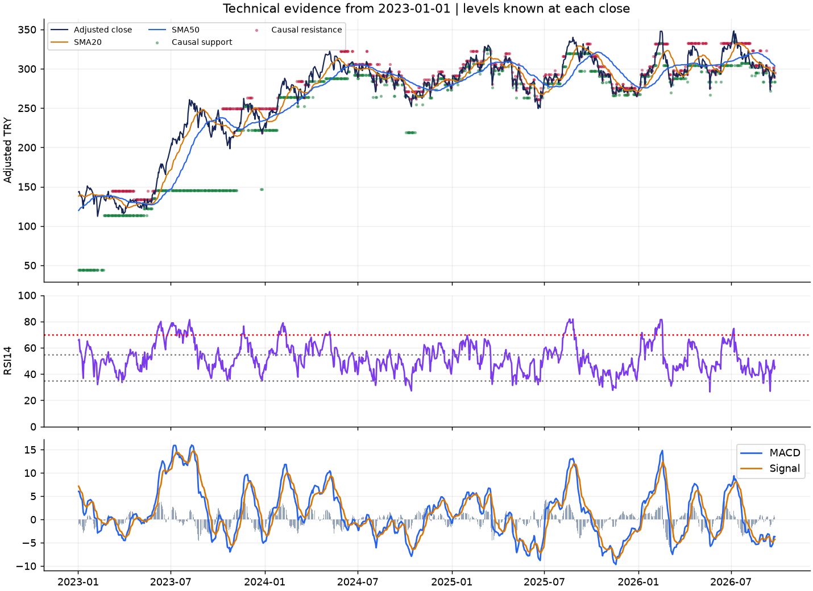
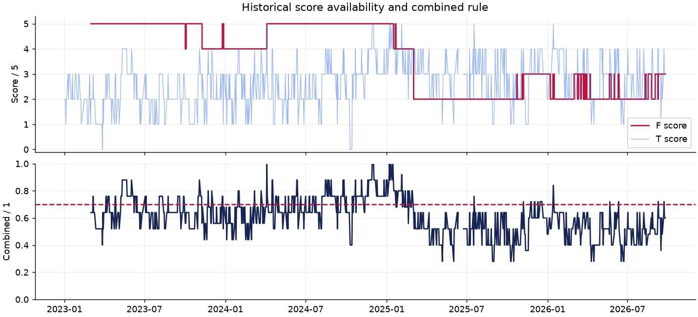
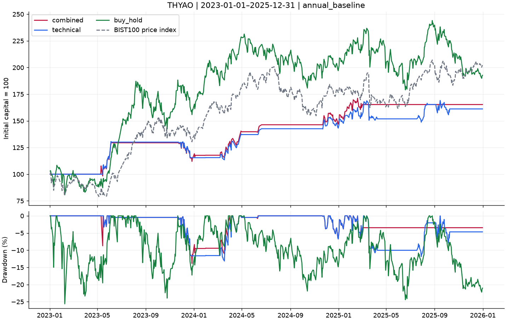

# Turkish Airlines: technical and fundamental strategy study

**CSE481 term project | 15 September 2026 | Educational research**

Verified annual Fintables original statements. Comparative revisions enter only after publication. Original TRY presentation; annual refresh; academic backtest with the limitations below.

## 1. Research question

Does a publication-lagged Fintables financial filter change the behavior of a causal technical strategy for Turkish Airlines, compared with technical-only trading, stock buy-and-hold and the BIST100 price index?

## 2. Scope and source quality

THYAO.IS; warm-up from 2021-01-01; evaluation 2023-01-01 through 2025-12-31; initial capital TRY 100,000. Fintables supplies 136 normalized observations over 5 financial period ends. Evaluation has 749 stock sessions; 710 have all five fundamental score inputs. Historical values come exclusively from Fintables. See ../../docs/DATA_SOURCES.md and the run manifest for provenance. The configured vintage policy is verified_only. Currency is TRY; source eligibility and revisions are documented in the manifest.

## 3. Method and timing

SMA20/50 and EMA20/50 use trailing closes; EMA uses a simple-average seed. RSI14 uses Wilder smoothing; MACD is EMA12 minus EMA26 with a nine-period signal. Volume features include relative volume, change and OBV. A pivot needs five observations on either side and becomes usable only on its fifth following session. Confirmed prices from the trailing 252 sessions form clusters with maximum 1.5% width and at least two touches. No later pivot is painted into an earlier decision. Financial snapshots join backward after their verified or explicitly assumed release date. Annual totals are not fourth-quarter flows. Original-report comparative revisions enter at the containing report's publication, never at the earlier period end.

## 4. Fundamental analysis at the final stock date

The following values are the latest modeled available financial period on 2026-09-25: 2024-12-31 00:00:00. Flows are trailing totals when enough same-basis YTD/annual observations exist; assets and debt are period-end balances in TRY. EBITDA and net debt follow the formulas documented in DATA_SOURCES.md. Net profit is parent-attributable; average equity/assets are used for ROE/ROA. Valuation uses raw stock price and nominal shares, with same-date FX conversion only when using USD fundamentals. Growth against a loss or missing denominator is unavailable. Deferred-tax gains, airline cycles, leases and exchange translation can distort apparent profitability.

| Metric | TRY millions |
| --- | --- |
| revenue | 745,430.00 |
| gross_profit | 142,908.00 |
| ebitda | 136,256.00 |
| operating_profit | 80,393.00 |
| net_profit | 113,378.00 |
| cash | 95,992.00 |
| financial_debt | 489,939.00 |
| net_debt | 236,664.00 |
| total_assets | 1,399,606.00 |
| equity | 679,887.00 |
| operating_cash_flow | 135,580.00 |
| investing_cash_flow | 10,003.00 |
| financing_cash_flow | -75,360.00 |

| Metric | Value |
| --- | --- |
| revenue_growth | 47.79% |
| net_profit_growth | -30.44% |
| ebitda_growth | 18.08% |
| roe | 19.94% |
| roa | 9.26% |
| ebitda_margin | 18.28% |
| net_margin | 15.21% |
| net_debt_ebitda | 1.74 |
| debt_equity | 0.72 |
| current_ratio | 1.01 |
| quick_ratio | 0.94 |
| pe | 3.54 |
| pb | 0.59 |
| ev_ebitda | 4.68 |

## 5. Explainable strategy

Each technical and fundamental component contributes one point. Fundamental conditions: sales growth >15%, earnings growth >15%, ROE >20%, net debt/EBITDA <4, and positive P/E at or below its prior 252-valid-session median (minimum 63). Technical conditions: SMA20 > SMA50, RSI 35–55, MACD above signal, relative volume >=1, and within 2% of support or inside a confirmed zone. Combined score = .6*T/5 + .4*F/5. Entry additionally requires F>=3, combined>=.70, complete/fresh fundamentals, trend and support. Exit on a close-triggered 8% loss, 40-session holding limit, unavailable/stale/weak fundamentals, trend reversal or RSI>=70. Exits take precedence; the next session open executes each decision. The 4x leverage threshold is a predeclared airline case-study assumption, not an established sector optimum.

## 6. Evaluation

The combined rule returned 65.32% with a maximum drawdown of -13.85% and 8 closed trades. Its endpoint return differed from BIST100 by -36.92 percentage points. Low activity is flagged rather than treated as evidence of robustness. These outcomes describe this dataset and frozen rule; they do not establish an investable advantage. Both sides pay 10 bps commission and 5 bps slippage. Fractional adjusted-price units avoid double-counting dividends; final positions are marked at close. Win rate counts closed net-profitable trades only. Sharpe annualizes observed daily returns at 252 with zero risk-free return; maximum drawdown includes initial capital. The BIST100 reference has no transaction costs and is a price index. Missing index sessions stay missing; its risk-metric observation count is reported.

| Strategy | Return | Max drawdown | Sharpe (rf=0) | Closed trades | Win rate | Exposure | Sessions |
| --- | --- | --- | --- | --- | --- | --- | --- |
| combined | 65.32% | -13.85% | 1.08 | 8 | 87.50% | 20.16% | 749 |
| technical | 61.19% | -13.16% | 1.00 | 11 | 63.64% | 26.70% | 749 |
| buy_hold | 92.73% | -25.61% | 0.75 | 0 | Unavailable | 100.00% | 749 |
| bist100 | 102.24% | -22.86% | 0.97 | — | Unavailable | Unavailable | 746 |

| Strategy | Net return | Gross, same executions |
| --- | --- | --- |
| combined | 65.32% | 69.33% |
| technical | 61.19% | 66.59% |
| buy_hold | 92.73% | 93.02% |

## 7. Chronological split

Each calendar-year evaluation starts flat with TRY100,000 and retains the preceding feature warm-up. They are independent starts and need not compound to the full-period result. The strategy settings remain fixed across the displayed periods. A partial final year is labeled explicitly and is not compared as though it were a full year.

| Year | Role | Combined return | Technical return | Buy/hold return | BIST100 return |
| --- | --- | --- | --- | --- | --- |
| 2023 | development | 15.26% | 15.48% | 60.29% | 34.15% |
| 2024 | validation | 24.81% | 23.98% | 20.16% | 30.34% |
| 2025 | holdout | 8.26% | 6.43% | -2.77% | 14.24% |

## 8. MCP AI agent

The stdio MCP server wraps the same local Python analytics, with typed inputs, bounded symbols/dates, structured values and explicit source warnings. The host computes no financial numbers independently: it calls history, indicators, zones, fundamentals, scores, signals and backtest tools, then explains the evidence. An actual Codex host trace and final answer are stored in ../agent, including a missing-data demonstration. Protocol tests independently compare tool results with direct Python calculations. Tools never place trades.

## 9. Verification and limitations

Unit tests independently check indicator recurrences, pivot confirmation, prefix invariance, release boundaries, later financial revisions, invalid denominators, next-open gaps, fees, position state and benchmark identities. These verify implementation behavior, not future investment performance. The original-report dataset has verified publication dates and separately dated comparatives; the earlier displayed-USD table study remains unverified. Further limits include one selected company, short evaluation, nominal TRY inflation, zero cash yield, simplistic slippage, fractional units, no taxes, unmatched benchmark return bases and index gaps. Original TRY accounts use nominal presentation and currency translation; their growth is not real growth or functional-USD growth. The original-report manifest includes page references, hashes and statement reconciliations.

## 10. Reproduction and follow-up

For the primary study, run .venv/Scripts/python.exe -m bist_analytics.cli --config config/tms29.yaml import-tms29, fetch --refresh, and run. The report, data, trades, signals, charts, metrics and source/code hashes are regenerated locally. The annual baseline remains available through config/project.yaml, and the earlier displayed-USD study through config/retrospective.yaml.

