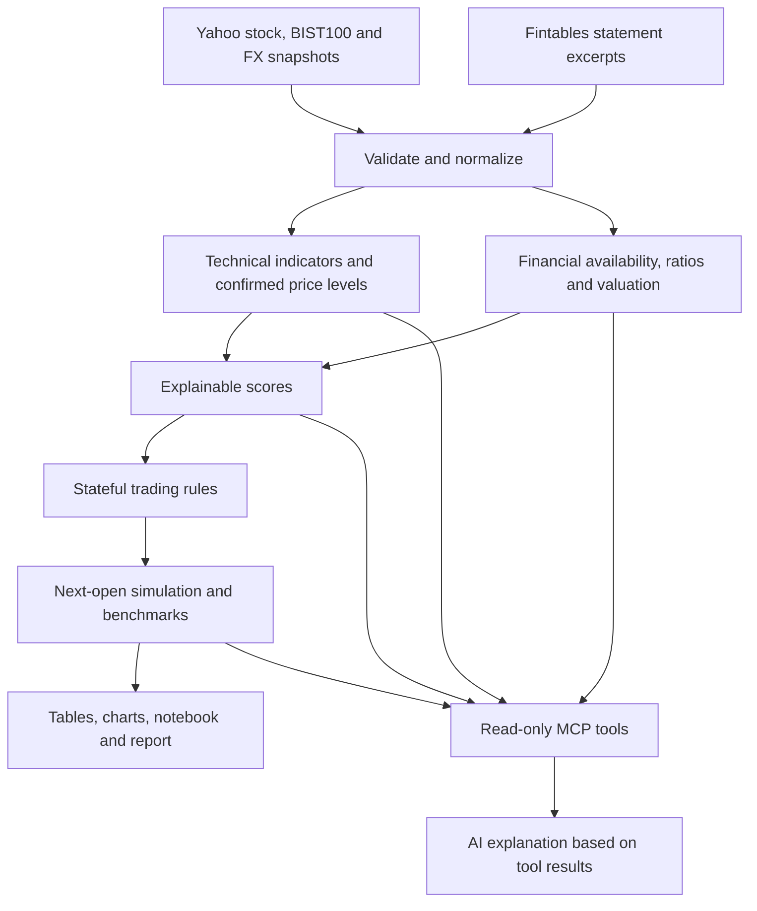

# THYAO project: implementation walkthrough

## 1. The question we are testing

We compare an explicit combined technical/fundamental rule with a technical-only rule, buying and holding THYAO, and the BIST100 price index. A lower return is a legitimate finding. The task is to implement an explainable experiment and verify its calculations.

The evaluation runs from 2 January 2023 to 31 December 2025, using earlier prices from 2021 for indicator warm-up. The financial dataset contains annual 2020-2025 values captured from Fintables, but FY2025 was released after the trading window and cannot enter 2025 decisions.

## 2. Follow the data through the application

### A. Configuration

Start with `config/project.yaml`. It fixes the company, dates, initial TRY100,000 capital, costs, thresholds and financial source policy. `config.py` validates the settings. The baseline was recorded before comparing returns; the 2025 holdout did not select the winning parameters.

The file explicitly chooses `retrospective`. The Python model defaults to `verified_only`. This makes the decision to permit unverified historical table versions visible rather than implicit.

### B. Source collection and validation

`data/market.py` downloads Yahoo THYAO.IS, XU100.IS and TRY=X with explicit parameters, validates dates/prices/volume and preserves raw prices, adjustments and actions. The cached files have hashes so an unnoticed input change is detected. Offline analysis needs no website login.

`data/fintables_import.py` converts selected Turkish statement rows into 102 normalized observations. For example, the displayed revenue `22.740.276` is 22,740,276 **thousand USD**, normalized once to 22,740,276,000 USD. Original Turkish labels remain in the raw TSV excerpts. EBITDA and net debt are derived from explicitly named Fintables inputs.

`schemas.py` and `data/fundamentals.py` retain reporting period, annual/instant basis, unit, currency, source reference, actual or assumed publication date, and whether the financial version is verified. A period-end date and a publication date mean different things.

### C. Technical evidence

`analysis/indicators.py` calculates SMA20/50, EMA20/50, RSI14, MACD12/26/9 and volume features. SMA smooths prices by averaging recent closes; EMA responds more to recent closes. RSI summarizes recent upward versus downward moves. MACD compares two exponential averages. Relative volume compares current activity with the trailing 20-session average.

`analysis/levels.py` finds local highs/lows and clusters nearby prices into support/resistance zones. A pivot must have five observations on both sides. A high seen on Monday cannot become a confirmed pivot until the five later observations arrive. Each day's zones include only pivots confirmed by that day. Tests check that adding future prices does not rewrite earlier levels.

### D. Financial evidence and timing

`analysis/fundamentals.py` builds annual/TTM flows and ratios from eligible observations. Balance-sheet quantities remain point-in-time balances. Annual revenue is not confused with standalone fourth-quarter revenue.

The backward availability join asks: **What financial snapshot was eligible on this trading date?** Date-only publications become usable at the first stock-session close strictly after publication; any resulting order executes at the following stock-session open. This is a conservative daily timing convention, not an exact intraday release simulation.

P/E, P/B and EV/EBITDA use raw share prices, nominal share units and same-date FX. Missing FX leaves valuation unavailable. Growth and profitability ratios use the declared comparable periods and denominators. Negative or missing comparison earnings do not silently become a normal growth percentage.

The included data's actual release timing and original values are only partly evidenced. `retrospective` permits current table versions with warnings. `verified_only` excludes them. A date lag alone cannot prove that a revised value existed in the past.

### E. Scoring

`analysis/scoring.py` gives each valid condition one point:

| Technical score T / 5 | Fundamental score F / 5 |
| --- | --- |
| SMA20 above SMA50 | Revenue growth >15% |
| RSI between 35 and 55 | Net-profit growth >15% |
| MACD above signal | ROE >20% |
| Relative volume at least 1 | Net debt/EBITDA <4 with positive EBITDA |
| Price close to support or inside a zone | Positive P/E no higher than its prior median |

The combined score is `0.60 × T/5 + 0.40 × F/5`. Missing components leave a score incomplete; they are not simply zero points.

Individual score conditions are not all mandatory entry conditions. For example, F=5 and T=3 gives 0.76 and can qualify even when the RSI point fails. Trend, support, financial completeness/freshness and the minimum F/combined scores are separate mandatory gates.

### F. Stateful decisions

`strategy/rules.py` produces BUY, SELL or HOLD using whether the simulation already owns a position. HOLD while flat means stay in cash; HOLD while invested means keep the existing position.

Combined entry requires trend/support gates, fresh complete fundamentals, F>=3 and combined>=0.70. While invested, exits have priority: an 8% close-triggered loss, 40-session limit, missing/stale/weak fundamentals, trend reversal, or RSI>=70. There is no repeated buy into an existing position and no immediate re-entry on an exit session.

The technical baseline requires T>=4 and removes fundamental exits. Therefore, the comparison changes entry-score composition and exit rules together. The combined trades need not be a strict subset of technical-only trades; this is not an isolated experiment on one financial ratio.

### G. Simulation and accounting

`backtest/engine.py` walks forward one stock session at a time:

1. At the open, execute the prior close's pending order.
2. Apply 5 basis points of slippage and 10 basis points of commission per side. Ten basis points is 0.10%.
3. Update cash and fractional synthetic adjusted units.
4. At the close, value the position and decide the next action.

Remaining positions are marked at the last close rather than forcibly sold. Open positions do not count toward closed-trade win rate. Adjusted prices already incorporate the provider's corporate-action adjustment; dividends are not added again. The simulation is an academic accounting model, not whole-lot exchange execution.

**Actual first trade:** the rule decided BUY on 22 November 2023 with T=3, F=5 and combined=0.76. It entered on 23 November at an adjusted fill of TRY256.316. The 13 December close triggered the stop; the exit filled on 14 December at TRY238.729. Net loss was TRY7,047.63, or 7.05% of the starting capital. The loss differs from the 8% trigger because the order fills at the next open, which can move either way. These rows are in `combined_orders.csv` and `combined_trades.csv`.

### H. Evaluation and outputs

`backtest/metrics.py` calculates cumulative return, drawdown, Sharpe, win rate, exposure, costs and benchmark differences. Maximum drawdown is the largest fall from a previous equity peak; it is not the worst single trade. Exposure is the fraction of sessions invested.

`pipeline.py` connects collection inputs, features, all strategies and annual evaluations. `reporting.py` creates tables and charts from those same results. Independent annual evaluations restart flat, so their returns need not compound to the continuous full-period result.

The fixed-execution gross counterfactual removes costs while retaining trade dates and sides. A separate zero-cost strategy rerun may choose different stop dates because the entry fill changes. Those two comparisons answer different questions.

### I. MCP and the actual AI agent

`mcp/server.py` exposes nine bounded, read-only tools around the Python functions. The AI host requests data, indicators, levels, fundamentals, scores, signals and backtests, then explains returned evidence. The calculations stay in Python and can also run from the CLI or notebook.

`outputs/agent/analysis_demo.jsonl` contains genuine model-to-tool calls. `analysis_demo.md` is the actual explanation. The missing-data demonstration shows that unavailable values remain null and invalid tickers are rejected. `recorded_demo.html` is an offline viewer of those recordings; opening it does not start a new live AI run.

## 3. Understanding the findings

| Strategy/reference | Return | Maximum drawdown | Closed trades | Exposure |
| --- | ---: | ---: | ---: | ---: |
| Combined | 26.24% | -10.81% | 8 | 20.03% |
| Technical only | 61.19% | -13.16% | 11 | 26.70% |
| THYAO buy-and-hold | 92.73% | -25.61% | 0; one position remains open | 100% |
| BIST100 price index | 102.24% | -22.86% | Not applicable | Not applicable |

The combined rule avoided much of the market exposure and had the smallest observed drawdown. It also missed substantial appreciation. With initial TRY100,000, its ending equity was TRY126,244, versus TRY192,726 for stock buy-and-hold. These are nominal TRY results with zero cash yield, not inflation-adjusted wealth comparisons.

Eight closed trades are too few for a broad conclusion about airlines or BIST stocks. A 62.5% win rate means five of eight closed trades were profitable; it does not establish robustness. The technical rule's zero-risk-free Sharpe was about 1.00 versus 0.63 for combined, so the lower drawdown did not make combined best on every risk measure.

At the final date, revenue growth 6.82%, profit growth -49.73% and ROE 19.85% miss their thresholds. Net debt/EBITDA 1.62 earns one point. P/E 2.49415 is slightly above its prior median 2.491647, so it earns no valuation point. Thus F=1. This score reflects discontinuous declared rules; it is not a comprehensive statement that the company is financially weak. A small change near a cutoff can change one point.

The final technical score is T=2 and combined is 0.32. The flat-position signal is HOLD with a failed trend filter. This is an as-of-31-December-2025 research signal, not today's recommendation.

See `FINANCIAL_INTERPRETATION.md` for earnings, cash flow, liquidity and valuation discussion. BIST100 is a price index with no modeled fees and three missing comparison sessions; the stock uses adjusted synthetic units. These differences limit direct comparison. Original financial vintages remain unverified, so the retrospective profit figures may change after source validation.

## 4. A practical reading and run order

1. Read this guide, then `config/project.yaml`.
2. Open `notebooks/THYAO_walkthrough.ipynb` and follow its nine executed code cells.
3. Inspect one source row, one feature date, one score calculation and one trade in the saved CSVs.
4. Open the HTML/PDF report and the recorded MCP viewer.
5. Use `README.md` to reproduce the cached analysis. `python -m bist_analytics.cli run` writes the selected-policy outputs. `run --strict` enforces original-vintage eligibility.

The existing verification evidence records 19 passing tests, matching fresh-environment results, nine successful notebook cells, and actual MCP host demonstrations. This walkthrough adds explanation only; no strategy threshold or performance result was changed.
