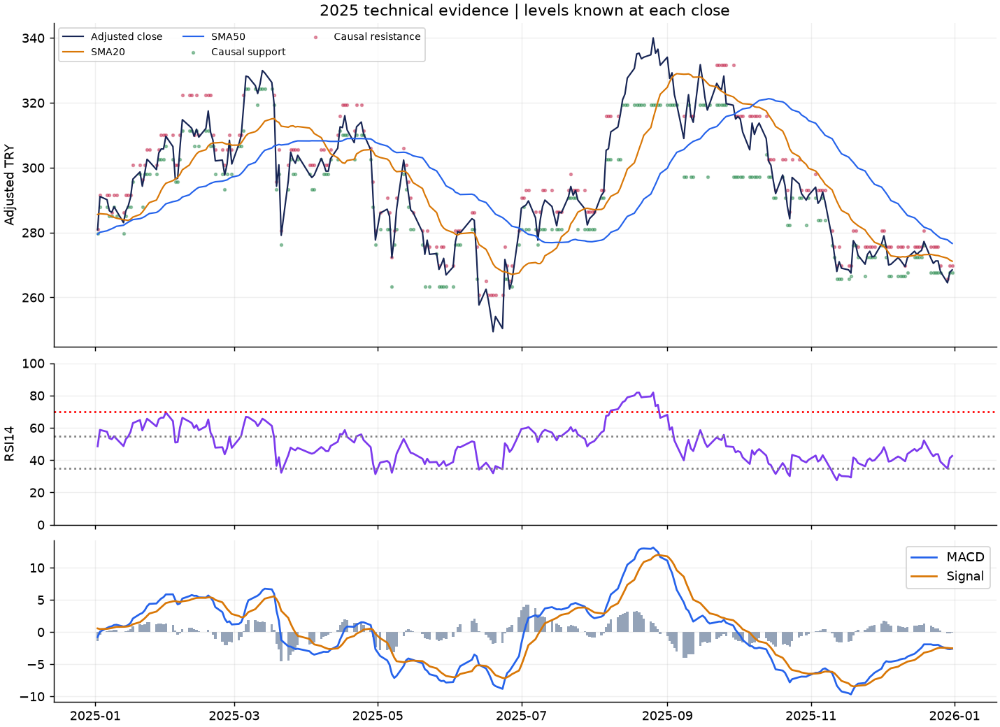
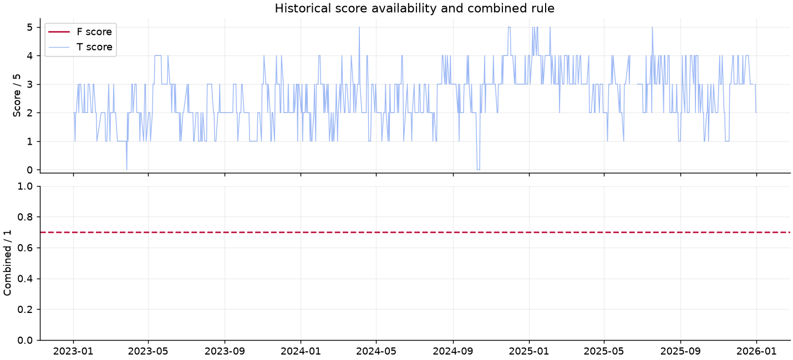
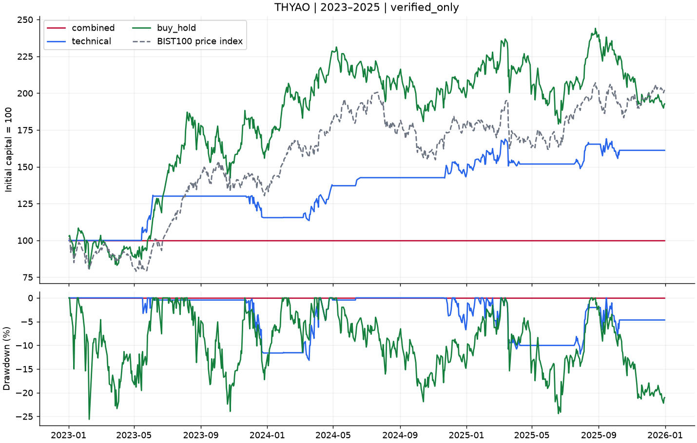

# Turkish Airlines: technical and fundamental strategy study

**CSE481 term project | 15 September 2026 | Educational research**

Verified-only source gate. Unverified financial observations are excluded. The combined strategy has no eligible fundamentals and stays in cash; this is a blocked data gate.

## 1. Research question

Does an annual Fintables financial filter change the behavior of a causal technical strategy for Turkish Airlines, compared with technical-only trading, stock buy-and-hold and the BIST100 price index?

## 2. Scope and source quality

THYAO.IS; warm-up from 2021; evaluation 2023–2025; initial capital TRY 100,000. Fintables supplies 102 normalized observations over six annual periods. Evaluation has 749 stock sessions; 0 have all five fundamental score inputs. Historical values come exclusively from Fintables. See ../../docs/DATA_SOURCES.md and the run manifest for provenance. The configured vintage policy is verified_only. Original-vintage validation remains incomplete.

## 3. Method and timing

SMA20/50 and EMA20/50 use trailing closes; EMA uses a simple-average seed. RSI14 uses Wilder smoothing; MACD is EMA12 minus EMA26 with a nine-period signal. Volume features include relative volume, change and OBV. A pivot needs five observations on either side and becomes usable only on its fifth following session. Confirmed prices from the trailing 252 sessions form clusters with maximum 1.5% width and at least two touches. No later pivot is painted into an earlier decision. Financial snapshots join backward after their verified or assumed release date. Annual totals are not fourth-quarter flows. Current table revisions remain a separate source of possible bias.

## 4. Fundamental analysis at the final stock date

The following values are the latest modeled available financial period on 2025-12-31: NaT. Flows are annual USD display totals; assets and debt are period-end USD display balances. The fully published 2025 statements are excluded from 2025 trading. EBITDA and net debt follow the formulas documented in DATA_SOURCES.md. Net profit is parent-attributable; average equity/assets are used for ROE/ROA. Valuation uses raw stock price and same-date USD/TRY. Growth against a loss or missing denominator is unavailable. Deferred-tax gains, airline cycles, leases and exchange translation can distort apparent profitability.

| Metric | USD millions |
| --- | --- |
| revenue | Unavailable |
| gross_profit | Unavailable |
| ebitda | Unavailable |
| operating_profit | Unavailable |
| net_profit | Unavailable |
| cash | Unavailable |
| financial_debt | Unavailable |
| net_debt | Unavailable |
| total_assets | Unavailable |
| equity | Unavailable |
| operating_cash_flow | Unavailable |
| investing_cash_flow | Unavailable |
| financing_cash_flow | Unavailable |

| Metric | Value |
| --- | --- |
| revenue_growth | Unavailable |
| net_profit_growth | Unavailable |
| ebitda_growth | Unavailable |
| roe | Unavailable |
| roa | Unavailable |
| ebitda_margin | Unavailable |
| net_margin | Unavailable |
| net_debt_ebitda | Unavailable |
| debt_equity | Unavailable |
| current_ratio | Unavailable |
| quick_ratio | Unavailable |
| pe | Unavailable |
| pb | Unavailable |
| ev_ebitda | Unavailable |

## 5. Explainable strategy

Each technical and fundamental component contributes one point. Fundamental conditions: sales growth >15%, earnings growth >15%, ROE >20%, net debt/EBITDA <4, and positive P/E at or below its prior 252-valid-session median (minimum 63). Technical conditions: SMA20 > SMA50, RSI 35–55, MACD above signal, relative volume >=1, and within 2% of support or inside a confirmed zone. Combined score = .6*T/5 + .4*F/5. Entry additionally requires F>=3, combined>=.70, complete/fresh fundamentals, trend and support. Exit on a close-triggered 8% loss, 40-session holding limit, unavailable/stale/weak fundamentals, trend reversal or RSI>=70. Exits take precedence; the next session open executes each decision. The 4x leverage threshold is a predeclared airline case-study assumption, not an established sector optimum.

## 6. Evaluation

The combined strategy remains in cash because the current financial vintages fail the source eligibility gate. Its zero return is not evidence of a successful trading strategy. Both sides pay 10 bps commission and 5 bps slippage. Fractional adjusted-price units avoid double-counting dividends; final positions are marked at close. Win rate counts closed net-profitable trades only. Sharpe annualizes observed daily returns at 252 with zero risk-free return; maximum drawdown includes initial capital. The BIST100 reference has no transaction costs and is a price index. Missing index sessions stay missing; its risk-metric observation count is reported.

| Strategy | Return | Max drawdown | Sharpe (rf=0) | Closed trades | Win rate | Exposure | Sessions |
| --- | --- | --- | --- | --- | --- | --- | --- |
| combined | 0.00% | 0.00% | Unavailable | 0 | Unavailable | 0.00% | 749 |
| technical | 61.19% | -13.16% | 1.00 | 11 | 63.64% | 26.70% | 749 |
| buy_hold | 92.73% | -25.61% | 0.75 | 0 | Unavailable | 100.00% | 749 |
| bist100 | 102.24% | -22.86% | 0.97 | — | Unavailable | Unavailable | 746 |

| Strategy | Net return | Gross, same executions |
| --- | --- | --- |
| combined | 0.00% | 0.00% |
| technical | 61.19% | 66.59% |
| buy_hold | 92.73% | 93.02% |

## 7. Chronological split

Each annual evaluation starts flat with TRY100,000 and retains the preceding feature warm-up. They are independent starts and need not compound to the full-period result. Baseline settings were recorded before strategy-return comparisons and are unchanged on the 2025 holdout. The sensitivity command reports predeclared 2023–2024 variants without choosing a winner.

| Year | Role | Combined return | Technical return | Buy/hold return | BIST100 return |
| --- | --- | --- | --- | --- | --- |
| 2023 | development | 0.00% | 15.48% | 60.29% | 34.15% |
| 2024 | validation | 0.00% | 23.98% | 20.16% | 30.34% |
| 2025 | holdout | 0.00% | 6.43% | -2.77% | 14.24% |

## 8. MCP AI agent

The stdio MCP server wraps the same local Python analytics, with typed inputs, bounded symbols/dates, structured values and explicit source warnings. The host computes no financial numbers independently: it calls history, indicators, zones, fundamentals, scores, signals and backtest tools, then explains the evidence. An actual Codex host trace and final answer are stored in ../agent, including a missing-data demonstration. Protocol tests independently compare tool results with direct Python calculations. Tools never place trades.

## 9. Verification and limitations

Unit tests independently check indicator recurrences, pivot confirmation, prefix invariance, release boundaries, later financial revisions, invalid denominators, next-open gaps, fees, position state and benchmark identities. These verify implementation behavior, not the accuracy of external providers. Historical Fintables vintages remain unverified; several release dates are assumed; annual refresh is slow. Further limits include one selected company, short evaluation, nominal TRY inflation, zero cash yield, simplistic slippage, fractional units, no taxes, unmatched benchmark return bases and index gaps. A primary point-in-time empirical claim requires dated Fintables original-vintage evidence. Strict mode intentionally refuses the present unverified data.

## 10. Reproduction and follow-up

Run .venv/Scripts/python.exe -m bist_analytics.cli import-fintables, then .venv/Scripts/python.exe -m bist_analytics.cli run. Use run --strict to enforce verified vintages. The report, data, trades, signals, charts, metrics and source/code hashes are regenerated locally. Before presenting, review the source limitation and distinguish retrospective findings from point-in-time validation. Presentation preparation and rehearsal follow implementation as requested.

